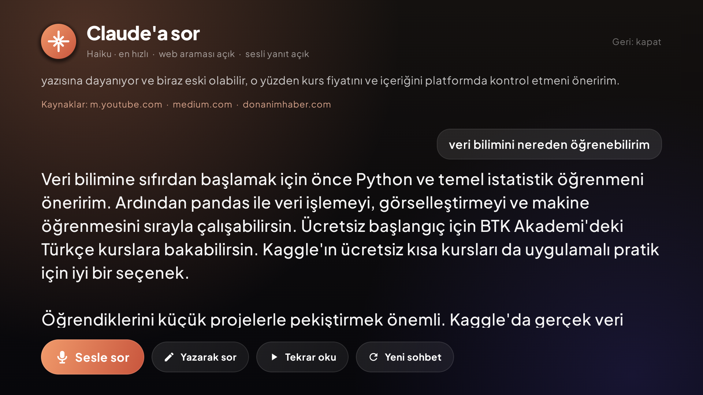

<p align="center">
  
</p>

<p align="center">
  <b>A fast, glass-styled home screen for Android TV & Google TV.</b><br>
  Ask Claude by voice · live football scores · continue watching across apps · two layouts · six built-in games · a cinematic screensaver · no ads, no root.
</p>

<p align="center">
  
  
  
  
  
  <a href="LICENSE"></a>
</p>

<p align="center">
  <a href="README.md">🇹🇷 Türkçe</a> ·
  <a href="#-features">Features</a> ·
  <a href="#-under-the-hood">Under the hood</a> ·
  <a href="#-install">Install</a> ·
  <a href="CHANGELOG.md">Changelog</a>
</p>

---

LiteDroid started as a weekend question — *"can my Chromecast with Google TV feel like an Apple TV?"* — and grew into a full launcher written from scratch in Kotlin and Jetpack Compose. It replaces the stock home screen with frosted-glass menus, a colorful showcase, a "continue watching" row that works across streaming apps, built-in remote-friendly games and a hand-drawn animated screensaver, while staying smooth on modest TV hardware.

## 📸 Screenshots

| Modern home | Apps |
|---|---|
|  |  |
| **Ask Claude** | **Quick panel** |
|  |  |
| **Score strip over Prime Video** | **Screensaver widgets** |
|  |  |
| **Built-in games** | **Sudoku** |
|  |  |
| **Tabbed settings** | **Casual layout** |
|  |  |

> The screenshots' UI is in Turkish; switch to English in Settings.

## ✨ Features

### Two layouts, one launcher
- **Modern** — tabbed navigation (Home · Apps · Games · Store), a rotating featured hero for your apps, wide card rows, search, a bell, quick settings, profile and a big clock. No bottom bar: the screen is all content; connection and weather live in the quick panel.
- **Casual** — a floating glass top bar with your favorite apps docked in the middle, a cinematic showcase that recolors itself after the focused app, and big bouncy tiles. Three showcase styles: *Cinematic*, *Card*, *Minimal*.
- Switch instantly in **Settings → Appearance → Layout**.

### Continue watching — across apps
- Picks up what you play in **YouTube, Prime Video, Apple TV, Netflix** and other video apps through Android media sessions; music apps (Spotify & co.) are left out.
- One card per piece of content (never duplicated), up to **3 unfinished items per app**. Several cards from the same app get their **own color, a number badge, "21 min left" and "2 h ago"**, so you can tell them apart even when the app doesn't share titles.
- Selecting a card opens YouTube at the **exact second**; apps without an exact content link are **launched fresh**, so you never land on a stale half-closed screen.
- Finished content drops off by itself. The bell menu doubles as a *Continue watching* list.

### Six built-in games, made for the remote
| | |
|---|---|
| 🐍 **Snake** | speeds up as you grow, best score saved |
| 📦 **Box Push** | five hand-made Sokoban levels, all verified solvable |
| 🏎️ **Mini Racer** | three lanes, rising speed, smooth 60 fps loop |
| 🔤 **SOS** | 6×6 board against a CPU that hunts for SOS lines and avoids setting you up |
| ❌ **Tic-Tac-Toe** | minimax opponent with a touch of randomness, so it can be beaten |
| 🔢 **Sudoku** | six puzzles (easy & medium), each verified to have a unique solution; number keys supported |

Installed games from Google Play get their own row underneath.

### ✨ Ask Claude — by voice, on your TV
- Press the sparkle button, **say your question**, and the answer streams onto the screen in large type, then is **read aloud**.
- Uses the Claude API with **web search** for anything current (tonight's matches, news, weather, release dates) and shows the **sources** it used.
- Follow-up questions keep the context; type instead of talking if you prefer. Sonnet (balanced) or Haiku (fastest).
- Runs on **your own Anthropic API key**, stored only on the device and sent straight to `api.anthropic.com`.

### ⚽ Live scores — Süper Lig, Premier League, LaLiga, Serie A, Bundesliga, Ligue 1
- Today's matches with team logos, live minute and score, and a **GOAL!** alert when the score changes.
- **Floating score strip**: while you watch Netflix, YouTube or anything else, a compact strip with logos and live scores sits in the top-right corner.
  - Shows **up to 3 matches**; with more live games it slides up to the next ones every 10 seconds, and the box shrinks to fit one or two.
  - **Goals, red cards and full time** pop open in their own animated box inside the strip, then it goes back to normal.
  - Never takes focus from the app below, and hides itself on the home screen, the screensaver and while the floating menu is open.
- Pick which leagues to follow.

### 🎛️ Floating menu over any app
- While Netflix, YouTube or anything else is open, **press Back twice** on the remote: a LiteDroid menu slides in with the clock, weather, now-playing controls, all of today's scores and the floating-strip switches. A single press stays a normal Back.
- Enable once: **Android Settings → Accessibility → LiteDroid remote shortcut** (it only sees key presses and which app is in front).

### 🧩 Quick panel
- Slides in from the right like Android's: now-playing card with controls, clock, weather, network, one-press tiles (layout, sounds, weather, animation, showcase) and shortcuts to all settings, the Store, Android settings and About. Scrolls when it gets long.

### ⚙️ Tabbed settings
- Settings are split into tabs on the left (Appearance, Profile, Weather, Sound, Screensaver, Live scores, Ask Claude, Content and privacy, More), with a hint for the focused row underneath. **More → Release notes** lists every version since the first one.

### 📊 Usage report
- **Settings → Content and privacy → Usage report** (needs usage access): screen time for Today / Yesterday / Last 7 days, an app ranking with share, opens, longest session and last use, an hour-of-day chart, a 7-day chart and the busiest hour.

### 🎧 Screensaver widgets
- **Now playing**: artwork, title, artist and a live progress bar for whatever is playing: Spotify, YouTube Music, Apple Music, TIDAL, Qobuz, Deezer, fizy… The same card is in the quick panel and floating menu.
- **Scores card** with today's matches and goal alerts, drifting slowly to protect the screen.

### And the rest
- **Store** — curated picks (streaming, Turkish platforms, music, players, tools) with *Popular / Free / Local* tags; installs and updates go through Google Play, LiteDroid never side-loads APKs.
- **Screensaver** — four scenes drawn entirely in code (*Movie night*, *Match day*, *Game time* synthwave, *Quiet night* aurora) behind a glass clock card, with drifting light dust. Can also be set as the system screensaver.
- **Sound & motion** — navigation, select, back and edge-bump sounds; spring animations with three speed presets.
- **Turkish & English** UI, switchable live. Weather from Open-Meteo, location by IP or a city you type.
- Favorites, hide/move apps, seven wallpapers, and *Back* never kicks you out of the launcher.

## 🛠 Under the hood

TV chips are slow at exactly the things launchers love: full-screen blur, shadows and stacked transparency. LiteDroid is built around avoiding them.

| Problem | What LiteDroid does instead |
|---|---|
| Animated wallpaper redrawn every frame | Baked once into a **320×180 bitmap**, then scaled by the GPU |
| `Modifier.blur` / live blur | Removed entirely; "blurred" app art is **pre-baked** to 64×36 / 40×40 bitmaps with a box blur at load time |
| `Modifier.shadow` on every card | A **few concentric rounded strokes** drawn behind the card (`softGlow`, `softShadow`) |
| `Crossfade` allocating offscreen layers | A custom **`FastCrossfade`** using `CompositingStrategy.ModulateAlpha` |
| Infinite transitions always running | Created **only while motion is on** and paused under menus |
| Recomposition from animated values | Animated values are **read in `graphicsLayer` / layout lambdas**, not in composition |

Other bits worth a look:
- **Media capture** (`media/NowPlayingStore.kt`): keys content by media id → real title → app, ignores fake titles such as an app echoing its own name, remembers the last id per session (some apps blank it mid-playback), filters trailers by requiring ~12 s of actual playback, keeps the last known position when an app reports 0 on stop.
- **Resume** (`media/Resume.kt`): exact deep links only (YouTube at the second); otherwise the app is launched fresh with a cleared task.
- **Live scores** (`data/Scores.kt`): ESPN's public scoreboard for six leagues, polled every 45 s while a match is live and every 5 min otherwise, only while something is listening; diffs produce Goal / RedCard / FullTime events with scorer and minute.
- **Overlays** (`overlay/`): the strip is a foreground service drawing into a non-focusable, non-touchable `TYPE_APPLICATION_OVERLAY` window that is fully hidden when empty; the menu is an accessibility service that catches a second Back within 320 ms and passes single presses through.
- **Remote input**: select fires on key-up only when armed (no accidental double actions), long-press on first repeat, focus memory that returns you to where you were after a menu closes.
- **i18n** with a tiny `tx("tr", "en")` helper and a static composition local so a language switch recomposes everything instantly.

## 📦 Install

**Requirements:** an Android TV / Google TV device (tested on Chromecast with Google TV, Android 14), a computer with `adb`, JDK 17.

```bash
git clone https://github.com/aliapaydin/litedroid_launcher.git
cd litedroid_launcher
./gradlew assembleRelease        # needs JDK 17 (macOS: export JAVA_HOME=$(/usr/libexec/java_home -v 17))
```

Enable **Developer options → Wireless debugging** on the TV, then:

```bash
adb pair  <TV_IP>:<PAIRING_PORT>      # first time only
adb connect <TV_IP>:<PORT>
adb install -r app/build/outputs/apk/release/app-release.apk
```

Press **Home** on the remote and choose **LiteDroid Launcher → Always**.

### One-time permissions (recommended)
Android TV doesn't expose these in its UI, so they're granted once over adb:

```bash
# Continue watching (media sessions)
adb shell cmd notification allow_listener dev.litedroid.launcher/dev.litedroid.launcher.media.MediaListenerService
# Real "recently used" list
adb shell appops set dev.litedroid.launcher GET_USAGE_STATS allow
# Optional: floating live-score strip over other apps
adb shell appops set dev.litedroid.launcher SYSTEM_ALERT_WINDOW allow
# Optional: use LiteDroid as the system screensaver
adb shell pm grant dev.litedroid.launcher android.permission.WRITE_SECURE_SETTINGS
adb shell appops set dev.litedroid.launcher WRITE_SETTINGS allow
```

### Ask Claude setup
1. Create an API key at [console.anthropic.com](https://console.anthropic.com) (usage is billed to your account).
2. Send it to the TV from your computer (typing it with the remote is tedious):
   ```bash
   adb shell am start -n dev.litedroid.launcher/.MainActivity --es claude_key "sk-ant-api03-..."
   ```
   or enter it in **Settings → Ask Claude → API key**.
3. Press the ✦ button in the top bar and ask away. Voice input uses the TV's built-in speech recognition; answers are read with its text-to-speech voice.

<details>
<summary>Make it the only home screen (optional, reversible)</summary>

```bash
adb shell pm disable-user --user 0 com.google.android.apps.tv.launcherx
adb shell pm disable-user --user 0 com.google.android.tungsten.setupwraith
# undo:
adb shell pm enable com.google.android.apps.tv.launcherx
adb shell pm enable com.google.android.tungsten.setupwraith
```
</details>

<details>
<summary>Grab screenshots from the TV</summary>

```bash
TV=<TV_IP>:<PORT> ./tools/tvshot.sh        # one shot
TV=<TV_IP>:<PORT> ./tools/tvshot.sh 5 1    # five shots, one second apart
```
DRM-protected playback (Netflix, Prime Video…) shows up black, that's Android's protection.
</details>

<details>
<summary>Troubleshooting</summary>

| Problem | Where to look |
|---|---|
| No continue-watching cards | Grant the notification listener, then `adb logcat -s LiteDroidMedia` |
| No scores / no strip | Settings → Live scores: leagues and strip on? `adb logcat -s LiteDroidScores` |
| Home goes to the box's own launcher and it can't be disabled | Turn on the remote shortcut service; with "Send Home to LiteDroid" on, Home opens LiteDroid |
| Double Back does nothing | Is the accessibility service on? `adb logcat -s LiteDroidRemote` |
| Claude says "no credit" | Add credit to your Anthropic account |
</details>

## ℹ️ How "continue watching" behaves per app

Google TV keeps its own continue-watching data private to system apps, so LiteDroid works from what each app publishes in its media session:

| App | What it shares | What you get |
|---|---|---|
| YouTube | title, channel, artwork, position, video id | Titled card with artwork; resumes at the exact second |
| Prime Video | content id, position (no title) | One card per title (up to 3), numbered and colored |
| Apple TV | duration only | App card with time left |
| Netflix | nothing beyond play/pause | App card |

## 🗂 Project structure

```
app/src/main/java/dev/litedroid/launcher/
├── MainActivity.kt          Home intent, key handling, idle timer, sounds
├── LauncherViewModel.kt     Apps, favorites, settings, history, weather, network
├── I18n.kt                  Turkish / English
├── data/                    Apps, settings, weather, store, live scores, Claude client, text-to-speech
├── media/                   Media session listener, history store, resume logic
├── overlay/                 Floating score strip, remote shortcut service, floating menu
├── dream/                   System screensaver (DreamService)
├── games/                   Snake, Box Push, Mini Racer, SOS, Tic-Tac-Toe, Sudoku
└── ui/                      Modern & Casual layouts, cards, glass, screensaver, store, settings
```

**Stack:** Kotlin 2.0 · Jetpack Compose (BOM 2024.12, Material 3) · Coroutines · Coil 3 · Android Gradle Plugin 8.7 · minSdk 26 / targetSdk 35. No TV UI library, D-pad focus is handled by hand; no third-party UI kits: custom glyphs, the games and every screensaver scene are drawn in code. Sound effects were synthesized for the project.

## 🙏 Credits

- [Plus Jakarta Sans](https://github.com/tokotype/PlusJakartaSans) typeface, SIL Open Font License 1.1 ([license](licenses/PlusJakartaSans-OFL.txt))
- [Open-Meteo](https://open-meteo.com) weather data, [ipwho.is](https://ipwhois.io) approximate location
- [Claude API](https://platform.claude.com/docs) by Anthropic for *Ask Claude* (your own key)
- Match data from ESPN's public scoreboard feed (unofficial, no key; may change without notice)
- Jetpack Compose and Coil

## 📄 License

LiteDroid Launcher is open source under the [MIT License](LICENSE). The bundled Plus Jakarta Sans font keeps its own [SIL Open Font License](licenses/PlusJakartaSans-OFL.txt).

## 👤 Author

**Ali Apaydın** · [apaydin.a@gmail.com](mailto:apaydin.a@gmail.com)

If you try LiteDroid on your own TV, I'd love to see a screenshot. Issues, ideas and pull requests are welcome.
