<p align="center">
  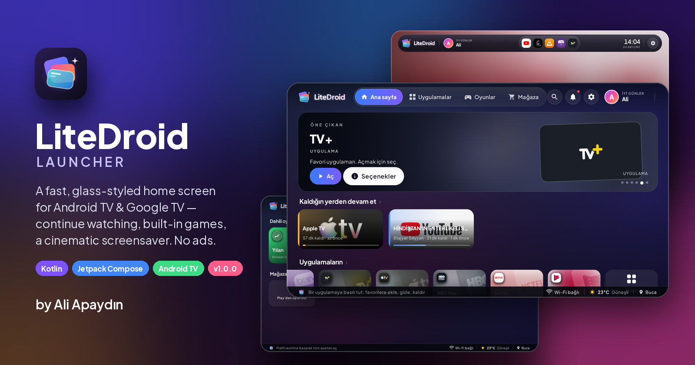
</p>

<p align="center">
  <b>Android TV ve Google TV için hızlı, cam görünümlü bir ana ekran.</b><br>
  Sesle Claude'a sor · canlı maç skorları · uygulamalar arası kaldığın yerden devam · altı dahili oyun · sinematik ekran koruyucu · reklamsız, root gerektirmez.
</p>

<p align="center">
  
  
  
  
  
  <a href="LICENSE"></a>
</p>

<p align="center">
  <a href="README.en.md">🇬🇧 English</a> ·
  <a href="#-özellikler">Özellikler</a> ·
  <a href="#-kaputun-altında">Kaputun altında</a> ·
  <a href="#-kurulum">Kurulum</a> ·
  <a href="docs/KURULUM.md"><b>📘 Resimli kurulum rehberi</b></a> ·
  <a href="CHANGELOG.md">Sürüm notları</a>
</p>

---

LiteDroid bir hafta sonu sorusuyla başladı: *"Chromecast with Google TV'm Apple TV gibi hissettirebilir mi?"* Sonra Kotlin ve Jetpack Compose ile sıfırdan yazılmış tam bir launcher'a dönüştü.

Standart ana ekranın yerine buzlu cam menüler, uygulamalar arası çalışan bir "kaldığın yerden devam et" rafı, sesle soru sorabildiğin bir yapay zekâ asistanı (Claude ya da Gemini), maç izlerken köşede duran canlı skorlar, telefonlarla oynanan bir bilgi yarışması, uyku zamanlayıcısı, kumandayla oynanan oyunlar ve kodla çizilmiş bir ekran koruyucu getiriyor. Bunların hepsini mütevazı TV donanımında akıcı kalarak yapıyor.

## ✨ Özellikler

### 🏠 Modern ana ekran

<p align="center">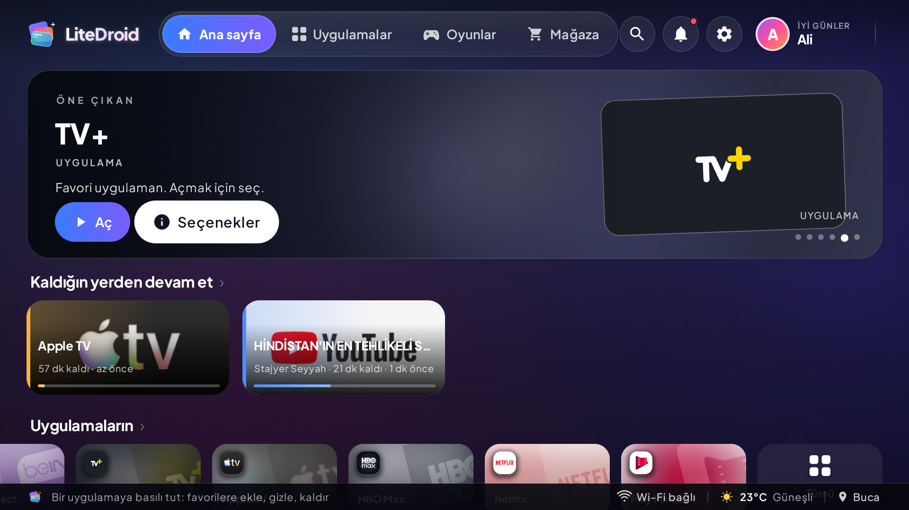</p>

- **Ana sayfa · Uygulamalar · Oyunlar · Mağaza** sekmeleri, uygulamalarını dönerek tanıtan bir vitrin ve geniş kart satırları.
- Üst barda Claude düğmesi, arama, bildirimler, hızlı panel, profil ve büyük saat. Alt kısımda bar yok, ekran tamamen içeriğe ayrılmış. Bağlantı ve hava durumu hızlı panelde.
- Bir uygulamaya basılı tutunca favorilere ekle, gizle ya da taşı.

| Uygulamalar | Klasik ("Casual") arayüz |
|---|---|
| 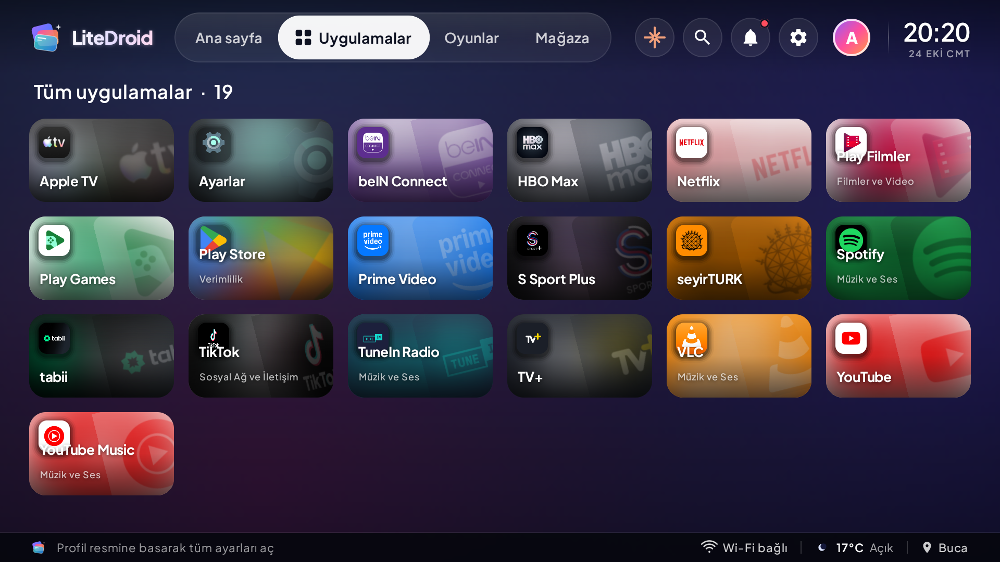 | 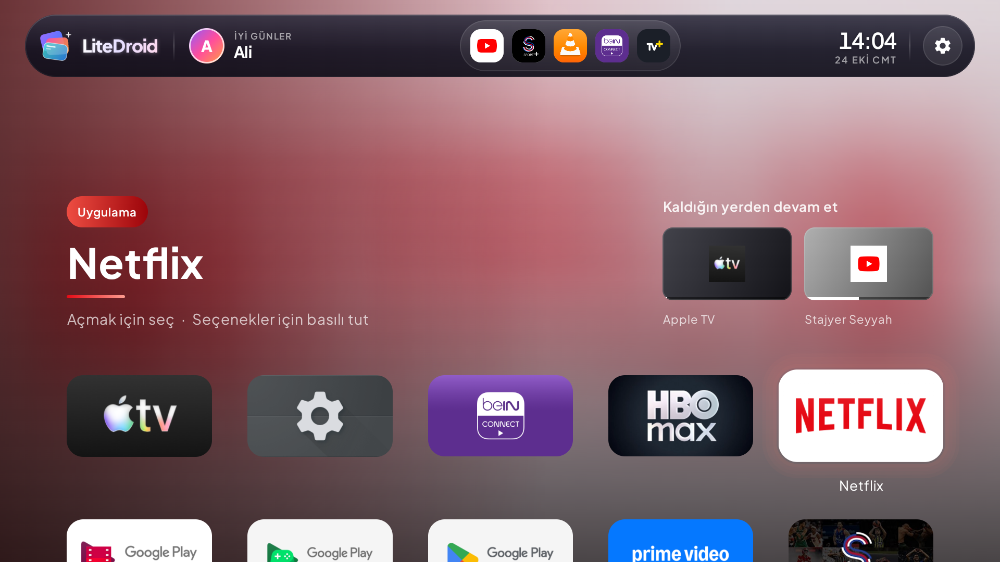 |

İstersen **Casual** arayüze geç: favori uygulamaların ortada durduğu yüzen bir cam bar, odaktaki uygulamanın rengini alan sinematik bir vitrin ve zıplayan büyük karolar. Ayarlar → Görünüm → Arayüz'den anında değişir.

### ▶️ Kaldığın yerden devam et

- YouTube, Prime Video, Apple TV, Netflix gibi uygulamalarda izlediklerini Android medya oturumlarından yakalar. Spotify gibi müzik uygulamaları bu rafa girmez.
- Her içerik tek kart olur ve bir uygulamadan **en fazla 3 yarım içerik** tutulur. Aynı uygulamadan birden fazla kart varsa her birinin kendi rengi, numarası, "21 dk kaldı" ve "2 sa önce" bilgisi olur.
- Karta basınca:
  - YouTube videoyu **kaldığı saniyeden** açar.
  - Tam içerik bağlantısı olmayan uygulamalar **temiz bir başlangıçla** açılır, yarım kalmış bir ekrana takılmazsın.

### ✨ Claude'a / Gemini'ye sor

| Konuşurken | Cevap |
|---|---|
| 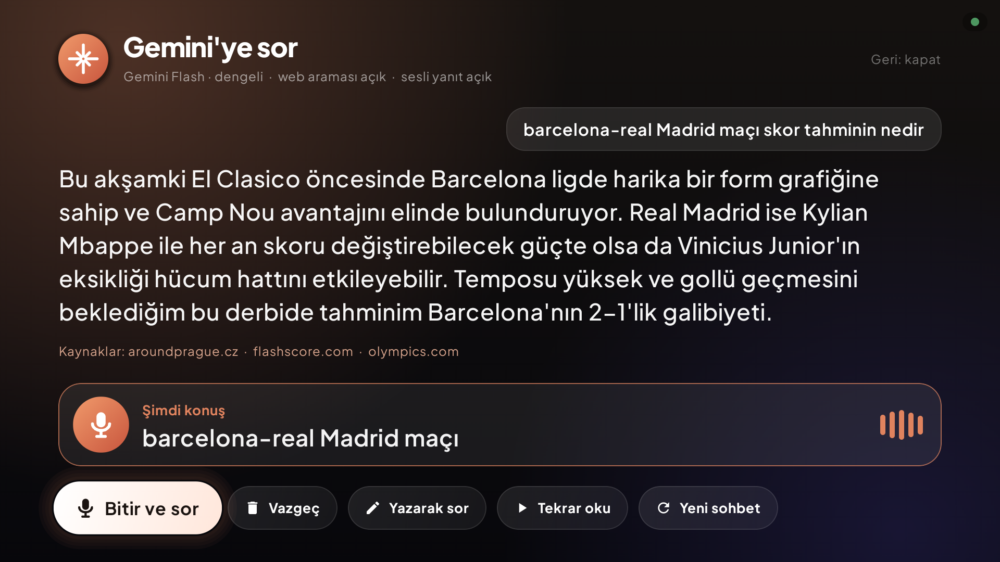 | 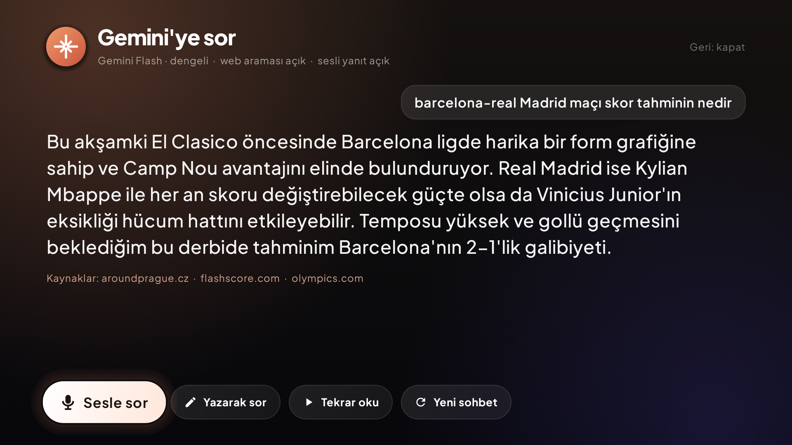 |

- Üst bardaki ✦ düğmesine bas. Mikrofon hazır olunca **"Şimdi konuş"** yazar ve söylediklerin konuşurken ekranda canlı görünür.
- Cevap ekranda büyük yazıyla akarak gelir. **İlk cümleden itibaren sesli okunmaya başlar**, sonuna kadar beklemez. Yeni soru sormak için bastığında önceki okuma anında durur.
- Güncel sorularda (bu akşamın maçları, haberler, hava, vizyondaki filmler) **web'de arar** ve kullandığı **kaynakları** altta gösterir.
- Takip soruları bağlamı korur. İstersen yazarak da sorabilirsin.
- **Gemini sesiyle okur:** Gemini anahtarın varsa cevaplar (Claude seçiliyken de) TV'nin düz sesiyle değil, Gemini'nin doğal ve duygulu sesleriyle okunur. Ayarlar → Claude'a sor → **Ses motoru**, **Anlatıcı sesi** (Sulafat, Achernar, Puck…) ve **Sesi dene**.
- **Claude ya da Gemini:** İkisinin de anahtarını girip Ayarlar → Claude'a sor → Yapay zekâ'dan istediğine geçebilirsin. Claude için Haiku ya da Sonnet, Gemini için Flash-Lite ya da Flash modelini seçebilirsin.
- Kendi API anahtarınla çalışır. Anahtar sadece TV'de saklanır ve doğrudan `api.anthropic.com`'a ya da Google'a gider. Kurulumu aşağıda: [Claude'a sor kurulumu](#claudea-sor-kurulumu).

### ⚽ Canlı skorlar

Süper Lig, Premier League, LaLiga, Serie A, Bundesliga, Ligue 1, **Şampiyonlar Ligi, Avrupa Ligi ve Konferans Ligi** varsayılan olarak takipte. Hangi ligleri izleyeceğini ayarlardan seçersin.

**Takımları seç:** Ayarlar → Canlı skorlar → Takımları seç. Her ligden yalnızca istediğin takımları takip edebilirsin, mesela Süper Lig'den Beşiktaş ve Galatasaray, LaLiga'dan Real Madrid. Tümünü seçebilir, seçimi kaldırabilir ya da tek tek seçebilirsin. Skor kartı, şerit, menü, ekran koruyucu ve gol bildirimleri sadece bu takımların maçlarını gösterir.

<p align="center">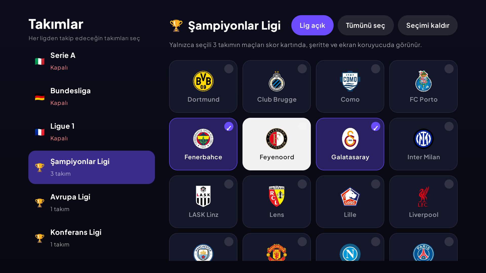</p>

<p align="center">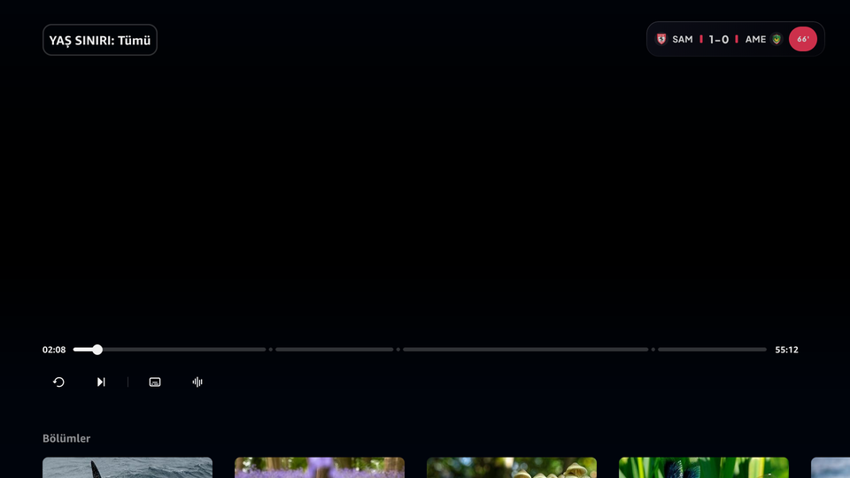</p>

**Yüzen skor şeridi:** Netflix, YouTube, Prime ya da başka bir şey izlerken sağ üst köşede küçük bir şerit durur.
- Takım logoları, skor ve dakika görünür.
- Aynı anda **en fazla 3 maç** gösterir. Daha fazla canlı maç varsa her 10 saniyede bir yukarı kayarak sıradaki maçlara geçer.
- Tek ya da iki maç varken koyu kutu ona göre küçülür.
- **Gol, kırmızı kart ya da maç sonu** olunca şeridin içinde ayrı bir kutu açılır ve animasyonla gösterir, sonra normale döner.
- Alttaki uygulamanın odağını hiç almaz. Ana ekranda, ekran koruyucuda ve yüzen menü açıkken kendiliğinden gizlenir.

<p align="center">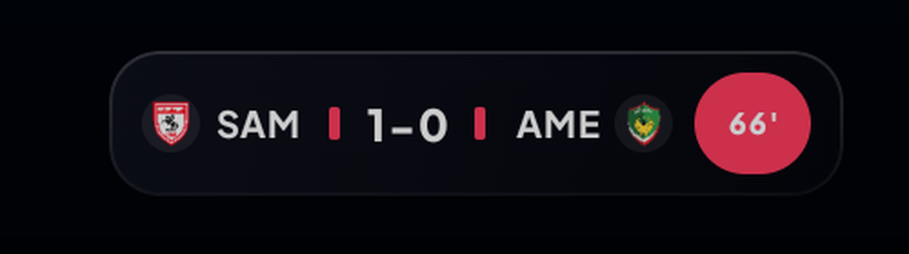</p>

### 🎛️ Her uygulamanın üstünde yüzen menü

<p align="center">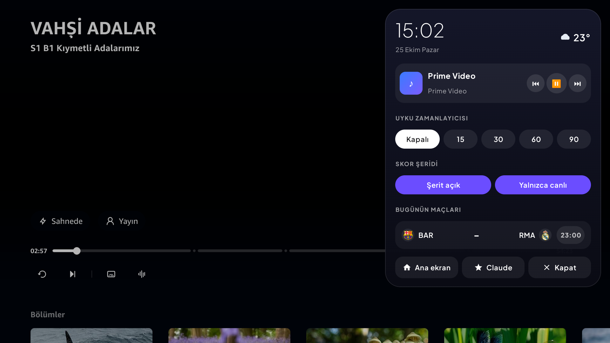</p>

- Netflix, YouTube ya da başka bir şey açıkken kumandada **Geri'ye iki kez hızlıca bas**.
- Sağdan kayarak sade bir LiteDroid menüsü açılır. İçinde saat, hava durumu, çalan müziğin kontrolleri, uyku zamanlayıcısı, skor şeridi ayarları, bugünün maçları ve Ana ekran / Claude / Kapat kısayolları var.
- **Tek basış normal Geri olarak çalışmaya devam eder.**
- Bir kez açman gerekiyor: **Android Ayarları → Erişilebilirlik → LiteDroid kumanda kısayolu**. Servis yalnızca tuş basışlarını ve öndeki uygulamanın adını görür.

### 😴 Uyku zamanlayıcısı

<p align="center">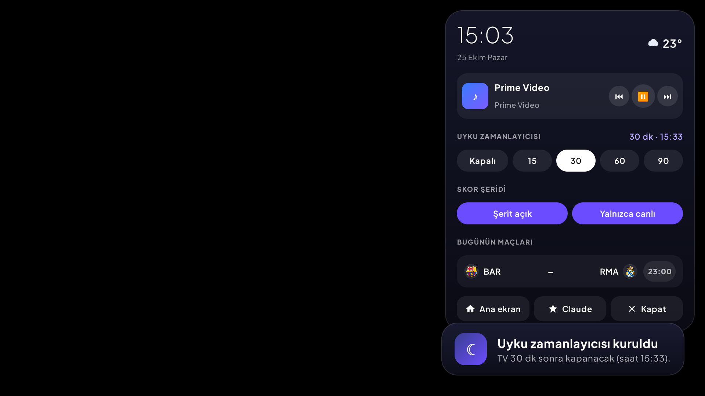</p>

- Ayarlar → Uyku zamanlayıcısı'ndan **süreyle** (15–120 dk) ya da **belirli bir saatte** kapan. Yüzen menüden ve hızlı panelden de tek tuşla kurulur.
- **İzlediğin bitince kapat** (yüzen menü): Netflix, YouTube, Prime Video ya da Apple TV'de oynatma durur ve 2 dakika içinde yeniden başlamazsa "İçerik bitti" uyarısıyla 5'ten geri sayıp kapanır. Otomatik sonraki bölümü kapatırsan bölüm bitince kapanır.
- Kapanmaya 45, 30, 15 ve 5 dakika kala sağ altta 5 saniyelik bir uyarı çıkar.
- Son 10 saniyede halkalı bir geri sayım görünür. Herhangi bir tuşa basarak iptal edebilirsin.
- Süre dolunca çalan durdurulur ve cihaz uyku moduna geçer. HDMI-CEC açıksa TV de kapanır.
- Kumanda kısayolu (erişilebilirlik) açık olmalı.

### 🧩 Hızlı panel

<p align="center">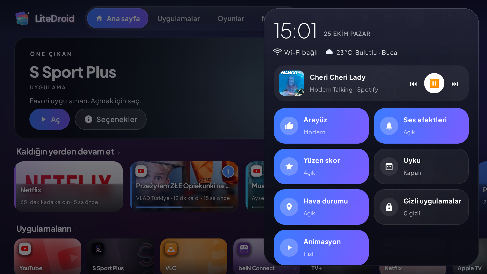</p>

Android'deki gibi sağdan kayarak açılan widget tarzı bir panel:
- Çalan müziğin kapağı ve kontrolleri.
- Saat, tarih, hava durumu ve ağ bağlantısı.
- Arayüz, ses efektleri, hava durumu, animasyon ve vitrin stili için tek tuşla değişen kutucuklar.
- Tüm ayarlar, Mağaza, Android ayarları ve Hakkında kısayolları.
- İçerik uzarsa panel kendi içinde kayar.

### 🌙 Ekran koruyucu

<p align="center">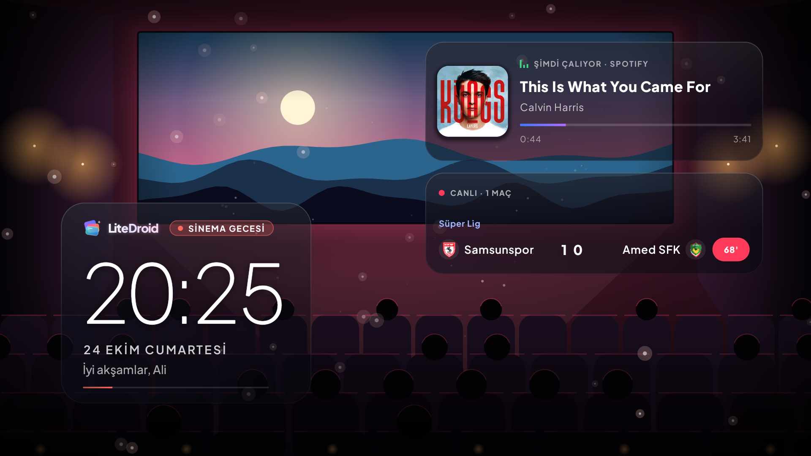</p>

- Tamamen kodla çizilmiş dört sahne: **Sinema gecesi, Maç günü, Oyun zamanı** (synthwave) ve **Sakin gece** (kuzey ışıkları).
- Cam bir saat kartı ve süzülen ışık tozları.
- **Şimdi çalıyor** kartı: Spotify, YouTube Music, Apple Music, TIDAL, Qobuz, Deezer, fizy… çalan her şeyin kapağı, adı, sanatçısı ve canlı ilerleme çubuğu. Aynı kart hızlı panelde ve yüzen menüde de var.
- **Canlı skor kartı:** Bugünün maçlarını ve gol bildirimlerini gösterir. Ekranı korumak için yavaşça yer değiştirir.
- İstersen sistem ekran koruyucusu olarak da ayarlayabilirsin.

#### 🎨 Canlı Tablo

Beşinci sahne yapay zekâyla resmediliyor. Ekran koruyucu açıldığında bir şehri **tam şu anki hâliyle** çiziyor: yerel saati, gerçek havası ve mevsimiyle. İstanbul'da akşam yağmur yağıyorsa ıslak sokaklar ve yanan ışıklar, Kyoto'da sabahsa sabah güneşi, Reykjavik'te kar yağıyorsa karlı evler görürsün.

- **Şehirler:** Senin şehrin, 16 şehirlik bir dünya turu (İstanbul, Kapadokya, Paris, Kyoto, Venedik, Santorini, Reykjavik, Banff…) ya da ikisi sırayla.
- **Stiller:** Yağlıboya, suluboya, Van Gogh tarzı, Japon baskısı, piksel sanatı ya da fotoğraf gibi.
- Altta şehrin adı, oradaki saat ve hava, sağ üstte senin saatin var. Tablo yavaşça kayar ve yenisine 3 saniyede karışır.
- Her şehir, gün dilimi, hava ve stil bir kez çizilip saklanır. Aynı koşullar geldiğinde tablo ücretsiz gösterilir. Gemini anahtarı gerekir. Ayarlar → Ekran koruyucu → Sahne: **Canlı Tablo**.

### 🌙 Masal Makinesi

Yatmadan önce çocuk kahramanı, yeri ve konuyu seçer: *"uçan bir kedi, denizin altında, arkadaşlık üzerine"*. Gerisini yapay zekâ yapar:

- **Yazar:** Gemini, ortasında bir seçim anı olan iki dallı bir masal yazar. Çocuk kumandayla yolu seçer, hikâye ona göre devam eder.
- **Çizer:** Her sayfa 16:9 bir resimli kitap sahnesi olarak çizilir. Karakterler her resimde aynı görünür.
- **Anlatır:** Anlatıcı Gemini sesiyle (varsayılan Sulafat, sıcak bir masalcı) okur; fısıldar, güler, duraksar. Karakterler kendi sesleriyle konuşur.
- **Film gibi akar:** Resimler yavaşça yakınlaşır, sayfalar yumuşakça geçer. Arkada cihazda anlık üretilen, sayfanın havasına göre değişen bir ninni çalar. Sen bir sayfayı dinlerken sonraki hazırlanır.
- **Uyutur:** İstersen masal bitince ekran kararır ve TV kendiliğinden kapanır.
- **Saklar:** Her masal resimleri ve sesleriyle kitaplıkta durur. Yeniden dinlemek ücretsizdir.

Gemini API anahtarı gerekir; kullanım senin hesabından ücretlendirilir. Resim sayısını (her sayfa, iki sayfada bir, sadece kapak, resimsiz) seçerek maliyeti ayarlayabilirsin. **Oyunlar** sekmesinde ya da **Ayarlar → Claude'a sor → Masal Makinesi**'nde.

### 🧠 Bilgi Yarışması (telefonlarla)

Kahoot tarzı bir yarışma: **Ekstra → Bilgi Yarışması**.
- TV'de bir QR kod çıkar. Telefonlar kamerayla okutup katılır. Android ve iPhone'da tarayıcıda açılır, uygulama gerekmez. Telefonlar TV ile aynı Wi-Fi ağında olmalı.
- Herkes adını ve avatarını seçer, en fazla 8 kişi oynayabilir.
- **12 kategori:** Genel kültür, Tarih, Coğrafya, Bilim, Teknoloji, Sinema, Müzik, Kitaplar, Sanat, Spor, Arabalar ve Oyun dünyası. **3 seviye:** Başlangıç, Orta, Zor. Sorular 388 soruluk havuzdan rastgele seçilir.
- Soru TV'de geri sayımla çıkar, cevaplar telefondan renkli düğmelerle verilir.
- Kimin cevapladığı anlık görünür. Hızlı ve doğru cevap daha çok puan getirir, üst üste doğru bilenlere seri bonusu var.
- Her sorudan sonra puan tablosu kayarak yeniden sıralanır, en sonda kürsü ve konfeti var.

| Lobi: QR kodla katıl | Soru |
|---|---|
| 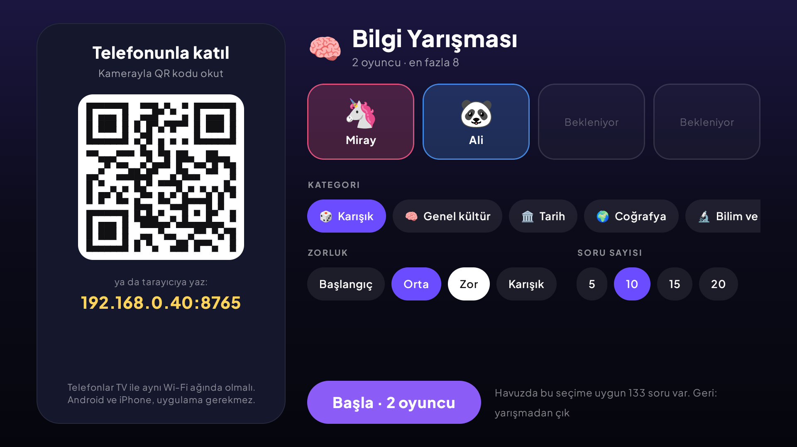 | 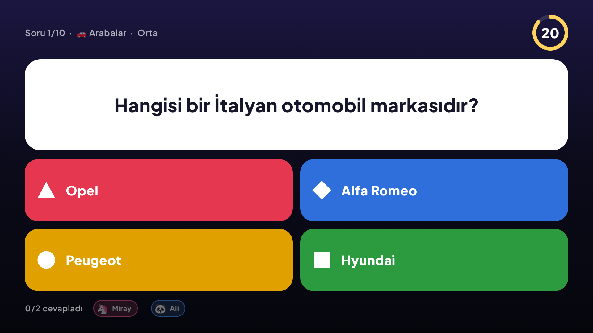 |
| **Puan durumu** | **Kürsü** |
| 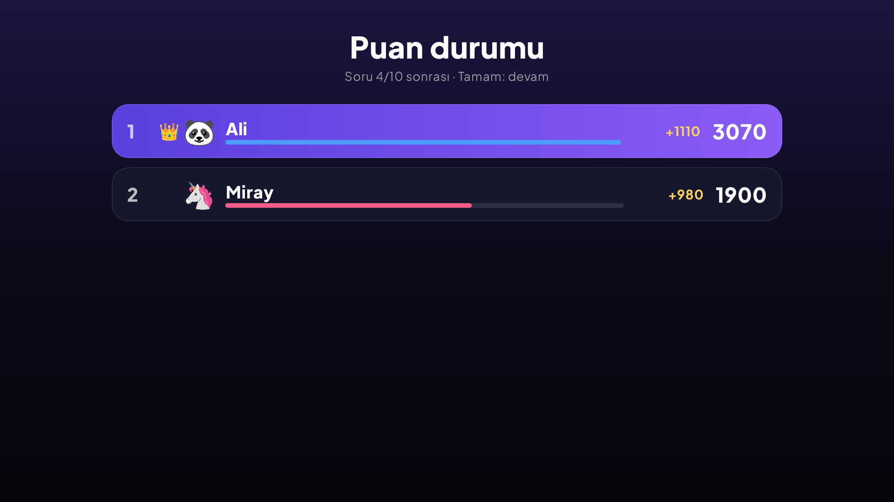 | 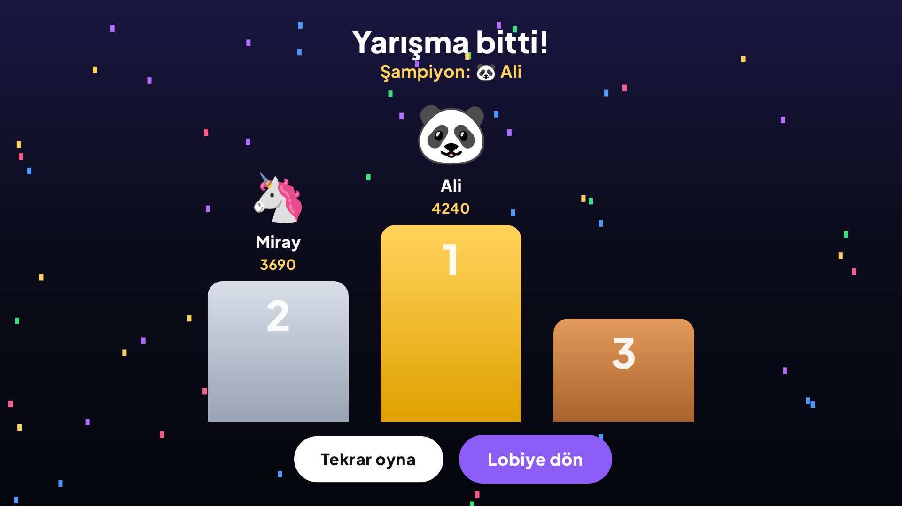 |

<p align="center">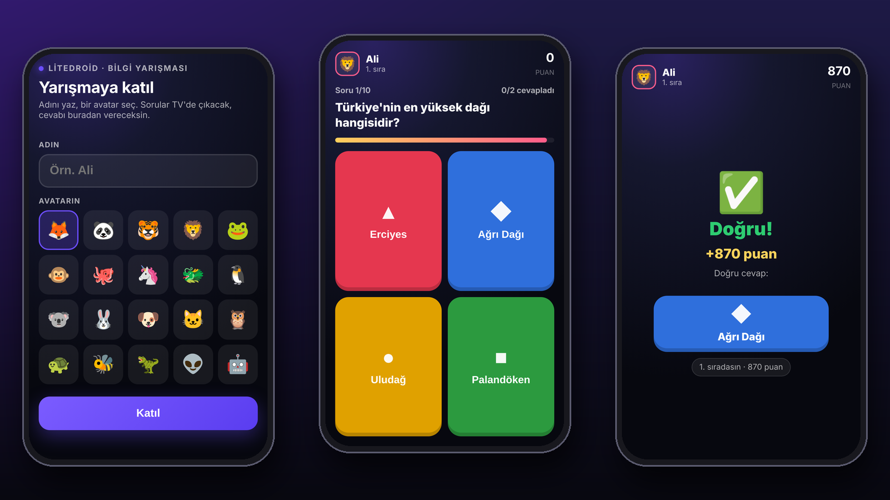</p>

### 🎮 Kumandaya göre yapılmış yedi oyun

| Oyunlar | Yılan | Sudoku |
|---|---|---|
| 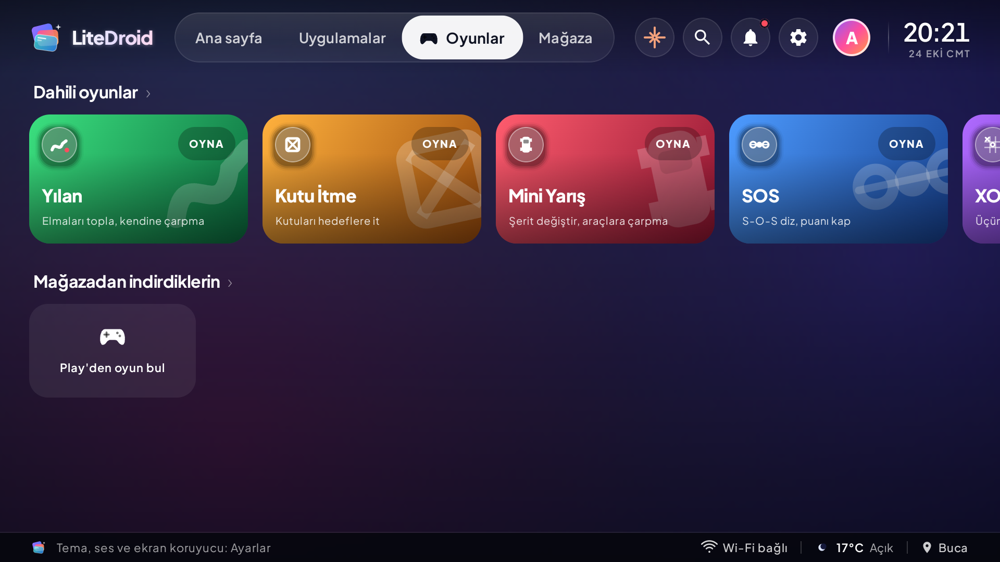 | 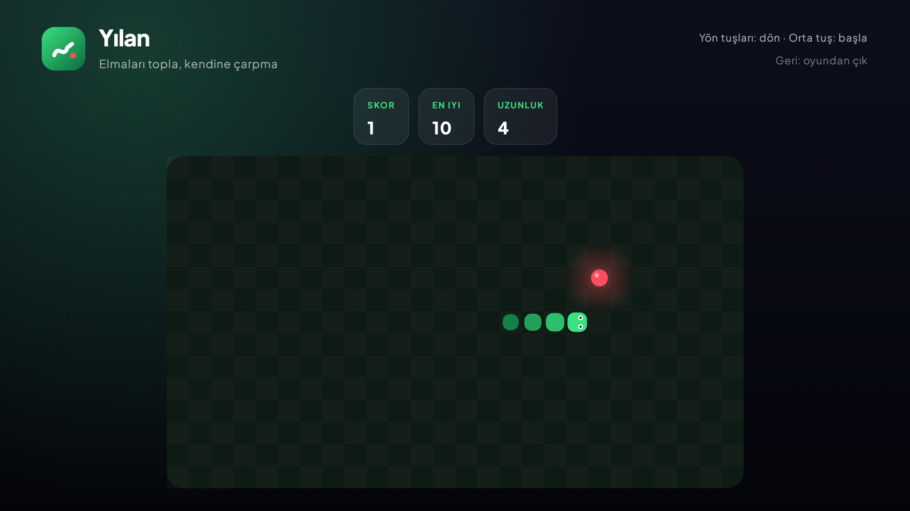 | 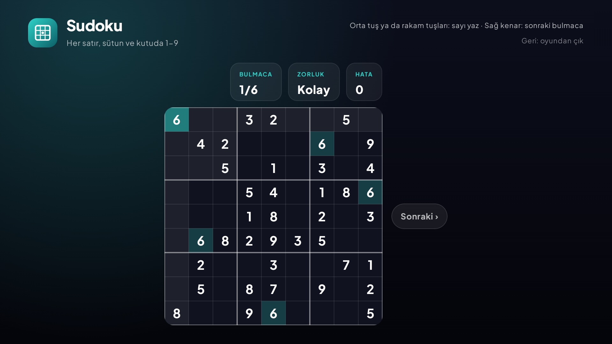 |

| | |
|---|---|
| 🐍 **Yılan** | Uzadıkça hızlanır, en iyi skor kaydedilir. |
| 📦 **Kutu İtme** | Elle tasarlanmış 5 Sokoban bölümü. Hepsinin çözülebildiği doğrulandı. |
| 🏎️ **Mini Yarış** | Üç şerit, artan hız, akıcı 60 fps. |
| 🔤 **SOS** | 6×6 tahtada, SOS kovalayan ve sana fırsat vermemeye çalışan bilgisayara karşı. |
| ❌ **XOX** | Minimax rakip, biraz rastgelelikle, yani yenilebilir. |
| 🔢 **Sudoku** | Kolay ve orta 6 bulmaca. Her birinin tek çözümü olduğu doğrulandı. Rakam tuşları da çalışır. |
| 💣 **Mayın Tarlası** | Kolay, Orta ve Zor seviyeler. Tamam ile açılır, basılı tutunca bayrak konur, ilk kare hep güvenlidir. |

Google Play'den yüklediğin oyunlar altta ayrı bir rafta durur.

### 🛠 Araçlar

**Ekstra** sekmesinde, Oyunlar rafının altında ayrı bir raf:

| | |
|---|---|
| 🌐 **Tarayıcı** | Cihazın kendi WebView motoruyla tek sekmeli, hafif bir tarayıcı. Kumandayla fare oku gezdirilir, Tamam tıklar, kenarlarda sayfa kayar. Sayfadaki arama kutularına TV klavyesiyle yazılır. **Kendi indiricisi** var: ilerleme ve hız görünür, APK'lar tek tuşla kurulur. Kapatınca bellekten tamamen silinir. |
| 🧮 **Hesap Makinesi** | Kumandayla gezilen tuş takımı. Kumandanın rakam tuşlarıyla da yazılır. Çarpma ve bölme önce yapılır, yazarken sonuç görünür, son işlemler yanda durur. |
| 🚀 **Hız Testi** | Cloudflare sunucularıyla ping, jitter, indirme ve yükleme ölçer. İbreli gösterge, "4K için yeterli mi?" yorumu ve son 5 test. |
| 📸 **Ekran Görüntüleri** | Herhangi bir uygulamadayken Geri'ye iki kez bas, yüzen menüden 📸 **Görüntü**'yü seç. Görüntüler TV'de ve Resimler/LiteDroid klasöründe saklanır, QR kodla telefona alınır. Netflix gibi korumalı içerikler siyah çıkar. |
| 🖥️ **Sistem Özellikleri** | Yonga, RAM, depolama, ekran modları ve HDR, desteklenen video ve ses biçimleri (HEVC, AV1, Dolby Vision, Atmos…), ağ ve LiteDroid izinlerinin durumu. |
| 🙂 **Avatar Düzenleyici** | Ten, saç, saç rengi, gözler, ağız, aksesuar (gözlük, taç, kulaklık…) ve arka plan seçerek avatar yaparsın. Kaydedilen avatar istersen üst bardaki profil resmin olur. |

### 🏡 Ev ve aile

| | |
|---|---|
| 📶 **Misafir Wi-Fi** | Hızlı panelde Wi-Fi QR'ı: misafir telefonun kamerasıyla okutup bağlanır, şifre yazdırmaya gerek kalmaz. |
| 📲 **Telefondan TV'ye gönder** | QR'ı okut, telefonda yaz: yazı TV'de seçili yazı kutusuna gider (Netflix şifresi, YouTube araması…), bağlantı LiteDroid tarayıcısında açılır. Kumandayla harf harf yazmak bitti. |
| ☔ **Sabah hava uyarısı** | Gün içinde yağmur, kar ya da fırtına bekleniyorsa sabah ana ekranda "15:00 civarı yağmur, şemsiyeni al" uyarısı. |
| ☕ **Mola hatırlatıcısı** | Bir uygulamada seçtiğin süre (30 dk - 2 sa) dolunca köşede nazik bir mola hatırlatması. |
| 🔒 **Uygulama kilidi** | Seçtiğin uygulamalar açılınca 4 haneli PIN sorulur. Ana ekranda uygulamanın üstünde Tamam'a basılı tut → **Kilitle (PIN)**. |

### ⚙️ Sekmeli ayarlar

<p align="center">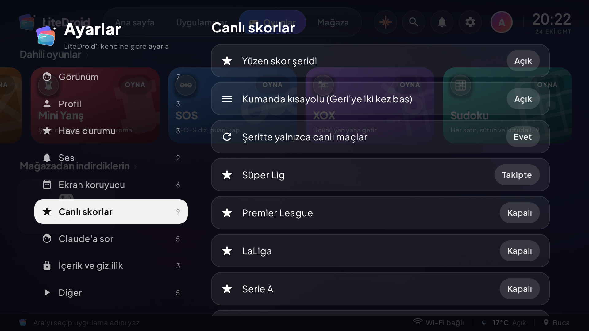</p>

Ayarlar solda sekmelere ayrılmıştır: **Görünüm, Profil, Hava durumu, Ses, Ekran koruyucu, Canlı skorlar, Claude'a sor, İçerik ve gizlilik** ve **Diğer**. Odaktaki satırın açıklaması altta görünür, kumandayla aradığını bulmak kolaydır. **Diğer → Sürüm notları**'nda ilk sürümden bugüne tüm yenilikler sürüm sürüm listelenir.

<p align="center">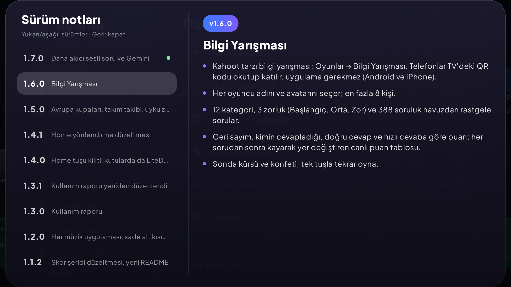</p>

### 📊 Kullanım raporu

**Ayarlar → İçerik ve gizlilik → Kullanım raporu** (kullanım istatistikleri izni gerekir):
- **Bugün, Dün ve Son 7 gün** için toplam ekran süresi ve düne göre fark.
- Uygulama sıralaması: toplam süre, yüzde payı, açılış sayısı, en uzun oturum ve son kullanım saati.
- Saatlere göre dağılım, son 7 günün grafiği ve en yoğun saat.
- Ana ekran ve ekran koruyucuda geçen süre sayılmaz.

| Özet ve grafikler | Uygulamalar |
|---|---|
| 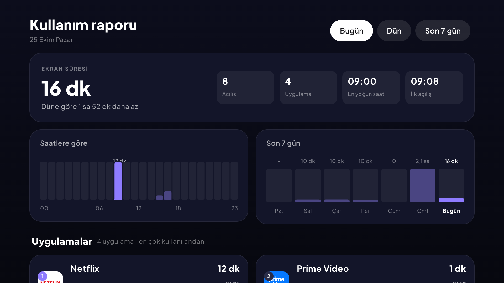 | 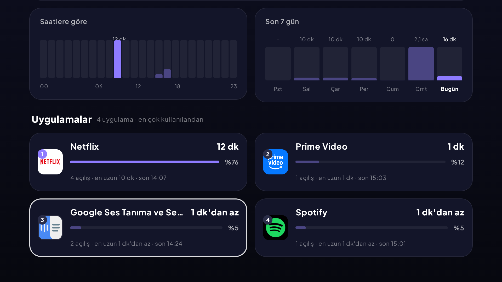 |

### 🔄 Kendi kendine güncelleme

- LiteDroid yarım saatte bir GitHub'daki son sürüme bakar.
- **Otomatik kur** modunda ekrana **"Yeni sürüm hazır"** sorusu gelir. **Şimdi güncelle**, **1 saat sonra** ya da **3 saat sonra** diyebilirsin.
- Güncelleme tam ekranda ilerleme çubuğuyla izlenir: İndir → Kur → Yeniden başlat. **Arka planda devam et** dersen sağ altta küçük bir kartta sürer. Çan menüsünden tekrar tam ekrana geçebilirsin.
- Bitince LiteDroid kendiliğinden yeniden açılır ve **"LiteDroid X sürümüne güncellendi"** ekranında yenilikleri gösterir.
- **Sadece haber ver** modunda yalnızca köşede bildirim çıkar, kurulum seçeneği yoktur. **Kapalı** modda hiç bakılmaz.
- İlk güncellemede Android bir kez onay ister, sonrakiler onaysız kurulur.
- Ayarlar → Diğer: **Güncellemeleri denetle** ve **Güncellemeler** (Otomatik kur / Sadece haber ver / Kapalı).
- Kurabilmesi için bir kez: `adb shell appops set dev.litedroid.launcher REQUEST_INSTALL_PACKAGES allow`

### Ve diğerleri

- **Mağaza:** Yayın platformları, yerli platformlar, müzik, oynatıcılar ve araçlardan seçilmiş uygulamalar. *Çok sevilen / Ücretsiz / Yerli* etiketleri var. Kurulum ve güncellemeler Google Play üzerinden yapılır, LiteDroid APK yüklemez.
- **Ses ve hareket:** Gezinme, seçme, geri ve kenara çarpma sesleri. Üç hız ayarlı yaylı animasyonlar.
- **Türkçe ve İngilizce arayüz.** Dil anında değişir.
- **Hava durumu** Open-Meteo'dan gelir. Konum IP'den bulunur ya da şehri kendin yazarsın.
- **Diğer:** Favoriler, uygulama gizleme ve taşıma, 7 duvar kâğıdı. Geri tuşu seni asla launcher'ın dışına atmaz.

<p align="center">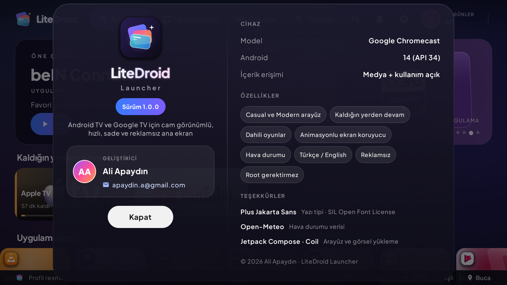</p>

## 🛠 Kaputun altında

TV çipleri, launcher'ların en sevdiği şeylerde zorlanır: tam ekran bulanıklık, gölgeler ve üst üste binen saydamlık. LiteDroid bunlardan kaçınacak şekilde tasarlandı.

| Sorun | LiteDroid'in çözümü |
|---|---|
| Hareketli duvar kâğıdı her karede yeniden çiziliyor | Bir kez **320×180'lik bir bitmap'e** pişirilip GPU ile ölçekleniyor |
| `Modifier.blur` / canlı bulanıklık | Hiç yok. Bulanık uygulama görselleri yüklenirken küçük bitmap'lere **önceden hazırlanıyor** |
| Her kartta `Modifier.shadow` | Kartın arkasına çizilen **birkaç ince yuvarlak halka** (`softGlow`, `softShadow`) |
| Ekran dışı katman açan `Crossfade` | `CompositingStrategy.ModulateAlpha` kullanan özel bir **`FastCrossfade`** |
| Sürekli çalışan sonsuz animasyonlar | **Sadece hareket açıkken** oluşturuluyor, menülerin altında duraklıyor |
| Animasyon değerlerinin ekranı yeniden kurması | Değerler `graphicsLayer` ve layout lambda'larında okunuyor, kompozisyonda değil |

**Canlı skor sistemi** (`data/Scores.kt`)
- ESPN'in herkese açık skor akışından 6 ligin günlük maçlarını çeker.
- Canlı maç varken her 45 saniyede, yokken her 5 dakikada bir yeniler.
- Ekranlar akışa abone olup bırakır. Kimse dinlemiyorsa ağ isteği atılmaz.
- Önceki ve yeni durumu karşılaştırıp **Gol, Kırmızı kart ve Maç sonu** olayları üretir. Golü atan oyuncu ve dakika da olaya eklenir.

**Yüzen şerit ve menü** (`overlay/`)
- Şerit, `TYPE_APPLICATION_OVERLAY` türünde, odak almayan ve dokunulamayan bir pencerede çizilen bir ön plan servisidir. Gösterecek bir şey yokken pencere tamamen gizlenir.
- Menü bir erişilebilirlik servisidir: Geri tuşunu dinler, 320 ms içindeki ikinci basışta `TYPE_ACCESSIBILITY_OVERLAY` penceresini açar, tek basışı sisteme geri iletir.

**Claude entegrasyonu** (`data/ClaudeClient.kt`)
- Messages API'ye **akışlı (SSE)** istek atar. Cevap kelime kelime ekrana gelir.
- `web_search` aracıyla en fazla 3 arama yapar ve kaynakları gösterir.
- Ses girişi TV'nin kendi konuşma tanıma servisiyle, okuma ise TextToSpeech ile yapılır.

**Kaldığın yerden devam** (`media/`)
- İçerikleri medya kimliği → gerçek başlık → uygulama sırasıyla eşleştirir. Uygulamanın kendi adını başlık gibi gönderdiği sahte başlıkları yok sayar.
- Fragmanları elemek için başlıksız oturumlarda en az 12 saniye oynatma ister.
- Kesin içerik bağlantısı yoksa uygulamayı eski ekranına değil, baştan açar.

## 📦 Kurulum

> ### 📘 [Adım adım resimli kurulum ve güncelleme rehberi → docs/KURULUM.md](docs/KURULUM.md)
> Geliştirici modunu açmaktan IP/portu bulmaya, eşlemeden izinlere, ana ekran yapmaktan güncellemelere kadar her şey ekran görselleriyle anlatılıyor. İlk kez kuruyorsan oradan başla.

<p align="center"><a href="docs/KURULUM.md">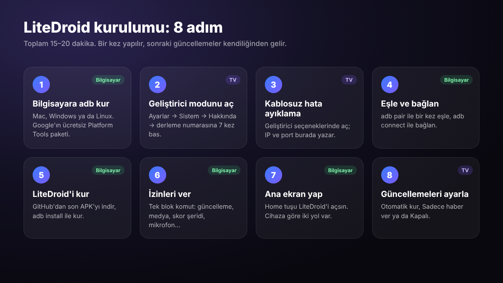</a></p>

### Hızlı kurulum (adb'yi biliyorsan)

**Gerekenler:** Android TV ya da Google TV (Android 8+; Chromecast with Google TV ve Botech Wzone'da denendi) ve `adb` kurulu bir bilgisayar.

1. TV'de **Geliştirici seçenekleri → Kablosuz hata ayıklama**'yı aç.
2. [Releases](https://github.com/aliapaydin/litedroid_launcher/releases/latest) sayfasından son `LiteDroid-X.Y.Z.apk`'yı indir.
3. Eşle, bağlan, kur ve izinleri ver:

```bash
adb pair  <TV_IP>:<EŞLEŞME_PORTU>     # sadece ilk sefer, TV'deki 6 haneli kodu sorar
adb connect <TV_IP>:<PORT>
adb install -r LiteDroid-X.Y.Z.apk

adb shell appops set dev.litedroid.launcher REQUEST_INSTALL_PACKAGES allow
adb shell cmd notification allow_listener dev.litedroid.launcher/dev.litedroid.launcher.media.MediaListenerService
adb shell appops set dev.litedroid.launcher GET_USAGE_STATS allow
adb shell appops set dev.litedroid.launcher SYSTEM_ALERT_WINDOW allow
adb shell pm grant dev.litedroid.launcher android.permission.RECORD_AUDIO
adb shell pm grant dev.litedroid.launcher android.permission.WRITE_SECURE_SETTINGS
adb shell appops set dev.litedroid.launcher WRITE_SETTINGS allow
adb shell settings put secure enabled_accessibility_services dev.litedroid.launcher/dev.litedroid.launcher.overlay.RemoteKeyService
adb shell settings put secure accessibility_enabled 1
```

4. Kumandada **Home**'a bas ve **LiteDroid Launcher → Her zaman**'ı seç. Google TV'de seçim çıkmaz, aşağıdaki "Tek ana ekran yap" komutlarını kullan. Kutu buna da izin vermiyorsa **Ayarlar → Kumanda → Home tuşunu LiteDroid'e yönlendir** açık kalsın.

| İzin | Ne işe yarar |
|---|---|
| `REQUEST_INSTALL_PACKAGES` | Kendi kendine güncelleme (TV menüsünden de verilebilir: Bilinmeyen kaynaklar) |
| Bildirim dinleyici | Kaldığın yerden devam, şimdi çalıyor kartları |
| `GET_USAGE_STATS` | Gerçek "son kullanılanlar" ve kullanım raporu |
| `SYSTEM_ALERT_WINDOW` | Yüzen skor şeridi ve uygulamaların üstündeki bildirimler |
| `RECORD_AUDIO` | Sesli soru (ilk kullanımda Android de sorar) |
| `WRITE_SECURE_SETTINGS`, `WRITE_SETTINGS` | LiteDroid'i sistem ekran koruyucusu yapmak |
| Erişilebilirlik servisi | Yüzen menü, uyku zamanlayıcısı, Home yönlendirme |

### 🔄 Güncellemeler

LiteDroid yarım saatte bir GitHub Releases'e bakar. **Ayarlar → Diğer → Güncellemeler**: **Otomatik kur** (ekrana "Şimdi güncelle · 1 saat · 3 saat sonra" sorusu gelir, ilerleme tam ekranda ya da köşede görünür, bitince kendiliğinden yeniden açılır), **Sadece haber ver** ya da **Kapalı**. İlk güncellemede Android bir kez onay ister; Play Protect uyarırsa **Yine de yükle**. Ayrıntılar [rehberin 8. bölümünde](docs/KURULUM.md#8-güncellemeler).

<details>
<summary>Kaynaktan derle (geliştirici için)</summary>

```bash
git clone https://github.com/aliapaydin/litedroid_launcher.git
cd litedroid_launcher
./gradlew assembleRelease        # JDK 17 gerekir (macOS: export JAVA_HOME=$(/usr/libexec/java_home -v 17))
adb install -r app/build/outputs/apk/release/app-release.apk
```
</details>

### Claude'a sor kurulumu

1. [console.anthropic.com](https://console.anthropic.com) adresinden bir API anahtarı oluştur ve hesabına bakiye yükle. Kullanım senin hesabından ücretlendirilir, Haiku en ekonomik seçenektir.
2. Kumandayla uzun anahtar yazmak zor olduğu için anahtarı bilgisayardan gönder:
   ```bash
   adb shell am start -n dev.litedroid.launcher/.MainActivity --es claude_key "sk-ant-api03-..."
   ```
   İstersen **Ayarlar → Claude'a sor → API anahtarı**'ndan da girebilirsin.
3. Üst bardaki ✦ düğmesine bas ve sor. İlk seferde mikrofon izni sorulur, **İzin ver** de. İstersen izni komutla da verebilirsin: `adb shell pm grant dev.litedroid.launcher android.permission.RECORD_AUDIO`

**Gemini kullanmak için:** [aistudio.google.com](https://aistudio.google.com) → **Get API key** ile bir anahtar al. Yeni anahtarlar `AQ.` ile, eskiler `AIza` ile başlar, ikisi de çalışır. Anahtarı şu komutla gönder, sonra Ayarlar → Claude'a sor → **Yapay zekâ: Gemini** seç:
```bash
adb shell am start -n dev.litedroid.launcher/.MainActivity --es gemini_key "AQ.Ab..."
```

> Anahtarını kimseyle paylaşma. Ekran görüntüsünde ya da bir yerde göründüyse konsoldan silip yenisini oluştur.

<details>
<summary>Tek ana ekran yap (isteğe bağlı, geri alınabilir)</summary>

```bash
adb shell pm disable-user --user 0 com.google.android.apps.tv.launcherx
adb shell pm disable-user --user 0 com.google.android.tungsten.setupwraith
# geri almak için:
adb shell pm enable com.google.android.apps.tv.launcherx
adb shell pm enable com.google.android.tungsten.setupwraith
```
</details>

<details>
<summary>Yeni sürüm yayınla (geliştirici için)</summary>

`app/build.gradle.kts`'te `versionCode` ve `versionName`'i artır, `Changelog.kt`'ye yeni sürümün notlarını ekle, sonra:

```bash
brew install gh && gh auth login      # sadece ilk sefer
./tools/release.sh
```

Betik APK'yı derler, notları `Changelog.kt`'den alır ve GitHub'da `vX.Y.Z` adıyla yayınlar. TV'lerdeki LiteDroid yarım saat içinde görür. APK, TV'lere ilk kurulumu yaptığın bilgisayarda derlenmeli. Android yalnızca aynı anahtarla imzalanmış güncellemeyi kabul eder.
</details>

<details>
<summary>TV'den ekran görüntüsü al</summary>

```bash
TV=<TV_IP>:<PORT> ./tools/tvshot.sh        # tek görüntü
TV=<TV_IP>:<PORT> ./tools/tvshot.sh 5 1    # 1 saniye arayla 5 görüntü
```
DRM korumalı içerikler (Netflix, Prime Video…) siyah görünür. Bu Android'in korumasıdır.
</details>

<details>
<summary>Sorun giderme</summary>

| Sorun | Bakılacak yer |
|---|---|
| Kaldığın yerden devam kartı gelmiyor | Bildirim dinleyici iznini ver, sonra `adb logcat -s LiteDroidMedia` |
| Skorlar ya da şerit görünmüyor | Ayarlar → Canlı skorlar'da lig ve şerit açık mı? `adb logcat -s LiteDroidScores` |
| Home tuşu kutunun kendi ana ekranına gidiyor ve launcher kapatılamıyor ("This command is illegal") | Kumanda kısayolu servisini aç; Ayarlar'da "Home tuşunu LiteDroid'e yönlendir" açıkken Home LiteDroid'i açar |
| Geri'ye iki kez basınca menü açılmıyor | Erişilebilirlik servisi açık mı? `adb logcat -s LiteDroidRemote` |
| Claude "bakiye yok" diyor | Anthropic konsolunda hesabına kredi yükle |
| Claude anahtarı kabul etmiyor | Anahtar `sk-ant-api03-` ile başlamalı, adb komutuyla tam olarak gönder |
</details>

## ℹ️ Uygulamalara göre "kaldığın yerden devam"

Google TV kendi devam etme verilerini sadece sistem uygulamalarına açar. LiteDroid bu yüzden her uygulamanın medya oturumunda paylaştığı bilgiyle çalışır:

| Uygulama | Paylaştığı bilgi | Sonuç |
|---|---|---|
| YouTube | Başlık, kanal, kapak görseli, konum, video kimliği | Başlıklı, kapaklı kart. Tam kaldığın saniyeden açılır |
| Prime Video | İçerik kimliği, konum (başlık yok) | Her içerik için numaralı ve renkli kart (en fazla 3) |
| Apple TV | Sadece süre | Kalan süreyi gösteren uygulama kartı |
| Netflix | Oynat/duraklat dışında hiçbir şey | Uygulama kartı |

## 🗂 Proje yapısı

```
app/src/main/java/dev/litedroid/launcher/
├── MainActivity.kt          Ana ekran intent'i, tuşlar, boşta kalma zamanlayıcısı, sesler
├── LauncherViewModel.kt     Uygulamalar, favoriler, ayarlar, geçmiş, hava, ağ
├── I18n.kt                  Türkçe / İngilizce
├── data/                    Uygulamalar, ayarlar, hava, mağaza, skorlar, Claude istemcisi, sesli okuma
├── media/                   Medya oturumu dinleyicisi, geçmiş, devam ettirme mantığı
├── overlay/                 Yüzen skor şeridi, kumanda kısayolu servisi, yüzen menü
├── dream/                   Sistem ekran koruyucusu (DreamService)
├── games/                   Yılan, Kutu İtme, Mini Yarış, SOS, XOX, Sudoku
└── ui/                      Modern ve Casual arayüzler, Claude ekranı, hızlı panel, widget'lar, ayarlar
```

**Kullanılanlar:** Kotlin 2.0 · Jetpack Compose (BOM 2024.12, Material 3) · Coroutines · Coil 3 · Android Gradle Plugin 8.7 · minSdk 26 / targetSdk 35.

Hazır TV arayüz kütüphanesi yok, kumanda odağı elle yönetiliyor. Üçüncü parti arayüz kiti de yok: simgeler, oyunlar ve ekran koruyucu sahnelerinin hepsi kodla çiziliyor. Ses efektleri bu proje için sentezlendi.

## 🙏 Teşekkürler

- [Plus Jakarta Sans](https://github.com/tokotype/PlusJakartaSans) yazı tipi, SIL Open Font License 1.1 ([lisans](licenses/PlusJakartaSans-OFL.txt))
- Hava durumu için [Open-Meteo](https://open-meteo.com), yaklaşık konum için [ipwho.is](https://ipwhois.io)
- *Claude'a sor* için Anthropic'in [Claude API](https://platform.claude.com/docs)'si (kendi anahtarınla)
- Maç verileri ESPN'in herkese açık skor akışından gelir. Resmi değildir, anahtar gerektirmez ve haber verilmeden değişebilir.
- Jetpack Compose ve Coil

## 📄 Lisans

LiteDroid Launcher [MIT Lisansı](LICENSE) ile açık kaynaktır. Kodu kullanabilir, değiştirebilir ve paylaşabilirsin, yeter ki telif bildirimi korunsun. Pakete dahil Plus Jakarta Sans yazı tipi kendi [SIL Open Font License](licenses/PlusJakartaSans-OFL.txt) lisansıyla gelir.

## 👤 Geliştirici

**Ali Apaydın** · [apaydin.a@gmail.com](mailto:apaydin.a@gmail.com)

LiteDroid'i kendi TV'nde denersen bir ekran görüntüsü görmek isterim. Hata bildirimleri, fikirler ve pull request'ler her zaman açık.
