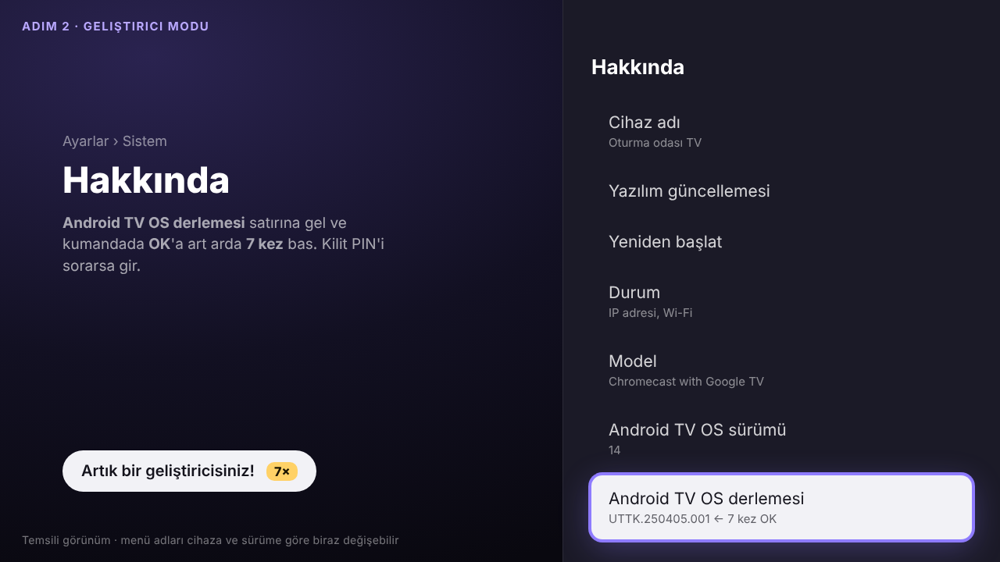
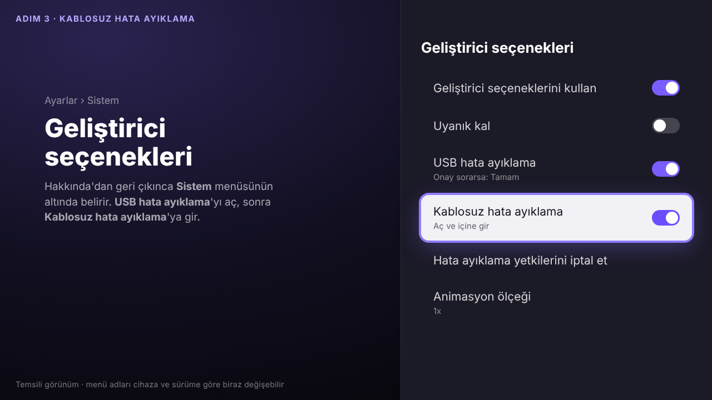
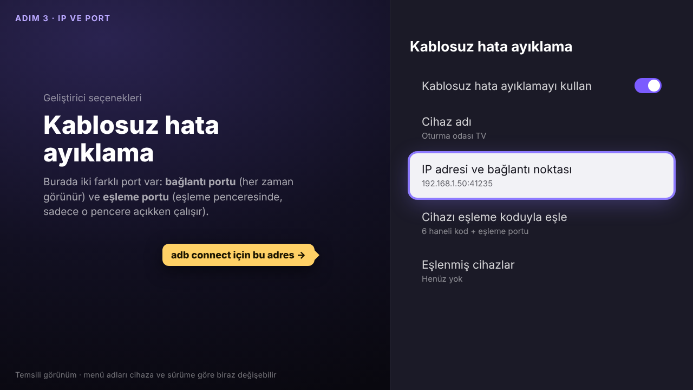
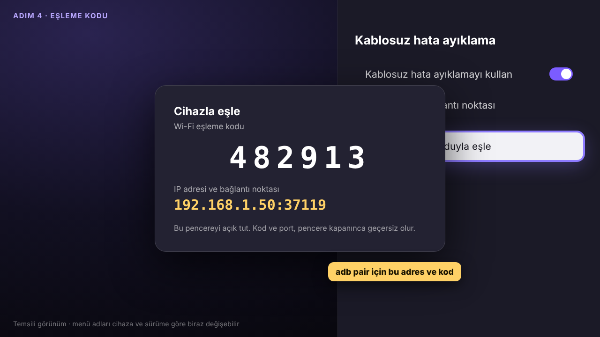
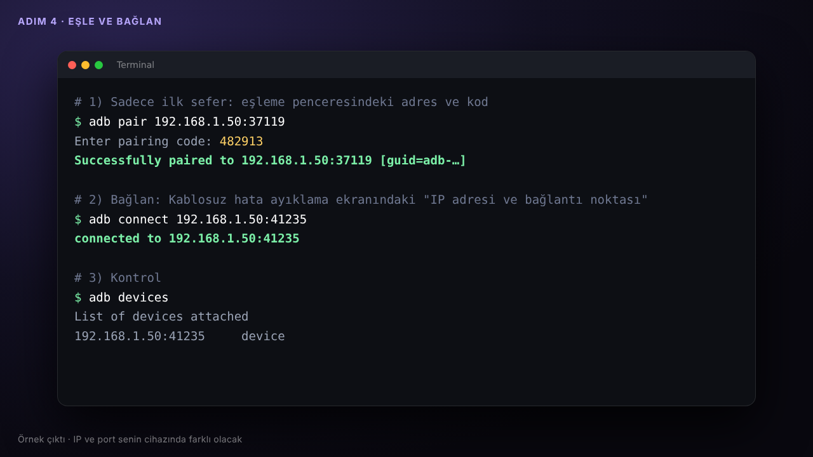
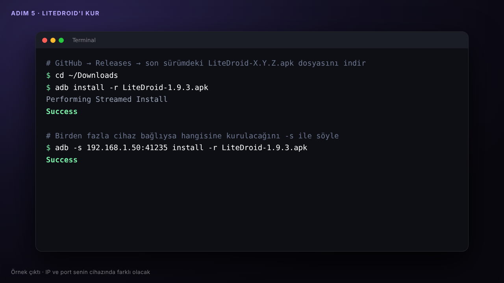
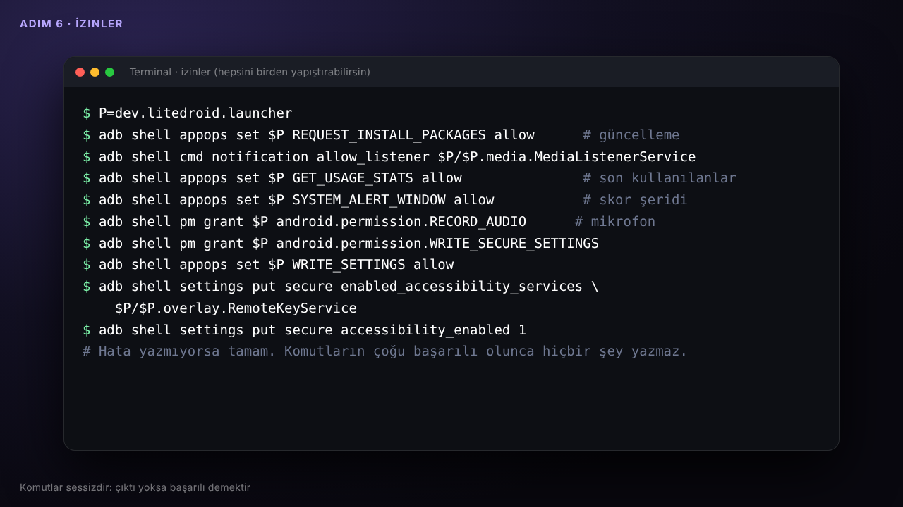
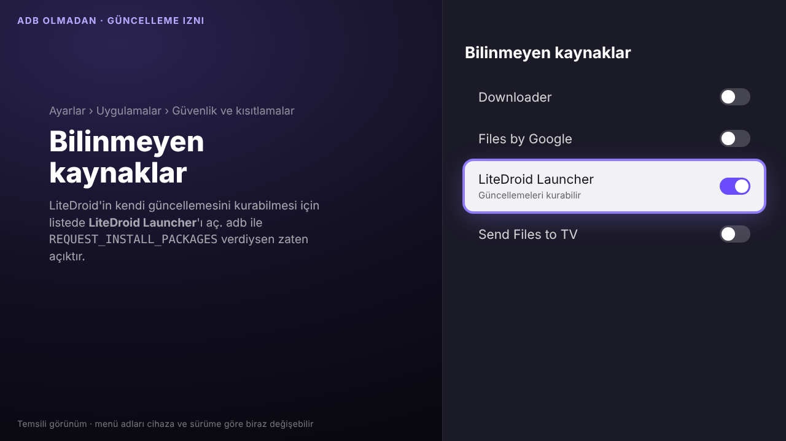
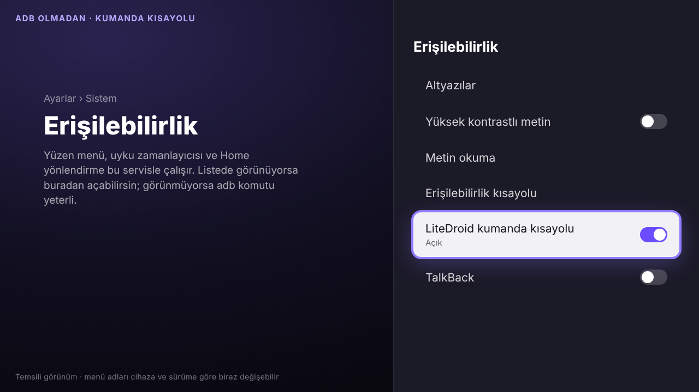
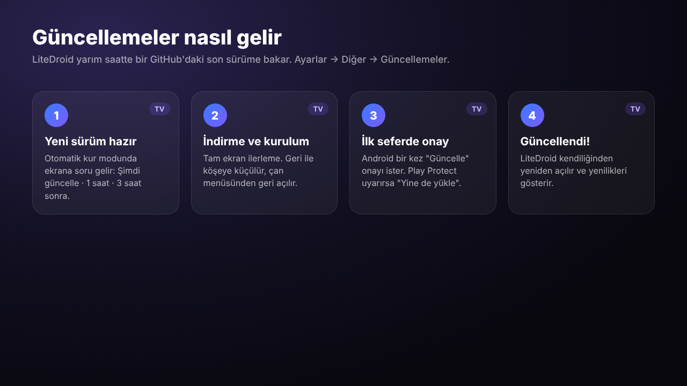

# LiteDroid Launcher · Kurulum ve Güncelleme Rehberi

Bu rehber LiteDroid'i **sıfırdan**, adım adım kurmak isteyenler için. Bilgisayardan birkaç komut yazacaksın; hepsi aşağıda, kopyala-yapıştır hazır. Toplam 15–20 dakika sürer ve **bir kez** yapılır. Sonraki sürümler TV'ye kendiliğinden gelir.


📄 **[Bu rehberi PDF olarak indir](LiteDroid-Kurulum-Rehberi.pdf)**

> **Not:** TV menüsü görselleri temsilidir. Menü adları cihaza, Android sürümüne ve dile göre biraz değişebilir. Örneklerdeki IP adresleri, portlar ve eşleme kodu senin cihazında farklı olacak.

---

## İçindekiler

0. [Neler gerekli?](#0-neler-gerekli)
1. [Bilgisayara adb kur](#1-bilgisayara-adb-kur)
2. [TV'de geliştirici modunu aç](#2-tvde-geliştirici-modunu-aç)
3. [Kablosuz hata ayıklamayı aç, IP ve portu bul](#3-kablosuz-hata-ayıklamayı-aç-ip-ve-portu-bul)
4. [Bilgisayarı TV ile eşle ve bağlan](#4-bilgisayarı-tv-ile-eşle-ve-bağlan)
5. [LiteDroid'i kur](#5-litedroidi-kur)
6. [İzinleri ver](#6-izinleri-ver)
7. [LiteDroid'i ana ekran yap](#7-litedroidi-ana-ekran-yap)
8. [Güncellemeler](#8-güncellemeler)
9. [İsteğe bağlı: Claude / Gemini anahtarı](#9-isteğe-bağlı-claude--gemini-anahtarı)
10. [Bilgisayarsız kurulum (kısıtlı)](#10-bilgisayarsız-kurulum-kısıtlı)
11. [Her şey tamam mı? Kontrol listesi](#11-her-şey-tamam-mı-kontrol-listesi)
12. [Sorun giderme](#12-sorun-giderme)
13. [Geri alma ve kaldırma](#13-geri-alma-ve-kaldırma)

---

## 0. Neler gerekli?

| | |
|---|---|
| **TV cihazı** | Android TV ya da Google TV (Android 8 ve üstü). Chromecast with Google TV (Android 14) ve Botech Wzone (Android 12) üzerinde denendi. |
| **Bilgisayar** | Mac, Windows ya da Linux. Yalnızca kurulum sırasında gerekir. |
| **Ağ** | TV ile bilgisayar **aynı Wi-Fi / modeme** bağlı olmalı. |
| **Kumanda** | Menülerde gezinmek için. |

**adb nedir?** Android'in resmî "bilgisayardan cihaza komut gönderme" aracı. Android TV, LiteDroid'in ihtiyaç duyduğu bazı izinleri (bildirim okuma, diğer uygulamaların üstünde gösterme gibi) kendi menüsünde göstermiyor. Bu izinler bir kez adb ile verilir.

---

## 1. Bilgisayara adb kur

<details open>
<summary><b>macOS</b></summary>

[Homebrew](https://brew.sh) kuruluysa Terminal'de şunu çalıştır:

```bash
brew install android-platform-tools
```
</details>

<details>
<summary><b>Windows</b></summary>

1. [developer.android.com/tools/releases/platform-tools](https://developer.android.com/tools/releases/platform-tools) sayfasından **SDK Platform-Tools for Windows** zip'ini indir.
2. Zip'i `C:\platform-tools` klasörüne çıkar.
3. O klasörde boş bir yere **Shift + sağ tık** yap ve **PowerShell penceresini burada aç** de.
4. Bu rehberdeki komutların başına `.\` ekle: `adb devices` yerine `.\adb devices`.
</details>

<details>
<summary><b>Linux (Ubuntu/Debian)</b></summary>

```bash
sudo apt install adb
```
</details>

Kurulduğunu kontrol et:

```bash
adb version
# Android Debug Bridge version 1.0.41 ... gibi bir satır görmelisin
```

---

## 2. TV'de geliştirici modunu aç



**Google TV (Chromecast with Google TV vb.):**
**Ayarlar → Sistem → Hakkında → Android TV OS derlemesi** satırına gel ve kumandada **OK**'a art arda **7 kez** bas.

**Klasik Android TV kutuları (Botech, Xiaomi Mi Box vb.):**
**Ayarlar → Cihaz Tercihleri → Hakkında → Derleme** satırına **7 kez** bas.

Ekranda *"Artık bir geliştiricisiniz!"* yazar. PIN sorarsa cihazın kilit PIN'ini gir.

---

## 3. Kablosuz hata ayıklamayı aç, IP ve portu bul



1. Bir geri çık. **Geliştirici seçenekleri** artık şurada görünür:
    - Google TV: **Ayarlar → Sistem → Geliştirici seçenekleri**
    - Klasik Android TV: **Ayarlar → Cihaz Tercihleri → Geliştirici seçenekleri**
2. **USB hata ayıklama**'yı aç. Uyarı çıkarsa **Tamam** de.
3. **Kablosuz hata ayıklama**'yı aç ve üzerine basıp içine gir.



Bu ekranda **IP adresi ve bağlantı noktası** yazar, örneğin `192.168.1.50:41235`. Bunu bir kenara not et. Bu **bağlantı adresi** ve adım 4'te `adb connect` için kullanılacak.

> **İki farklı port var, karıştırma:**
> - **Bağlantı portu**: Kablosuz hata ayıklama ekranında her zaman yazar. `adb connect` için.
> - **Eşleme portu**: Yalnızca "Cihazı eşleme koduyla eşle" penceresinde yazar. `adb pair` için, sadece ilk sefer.
>
> TV yeniden başlayınca ya da kablosuz hata ayıklamayı kapatıp açınca **bağlantı portu değişir**. Eşleme kalıcıdır, tekrar eşlemen gerekmez. Sadece yeni portu bu ekrandan okuyup `adb connect` yaparsın.

<details>
<summary><b>Menüde "Kablosuz hata ayıklama" yoksa (Android 10 ve öncesi)</b></summary>

Eski cihazlarda bunun yerine **Ağ hata ayıklama** ya da **ADB over network** seçeneği olur. Onu aç, sonra eşleme yapmadan doğrudan bağlan:

```bash
adb connect 192.168.1.50:5555
```

İlk bağlantıda TV'de *"USB hata ayıklamasına izin verilsin mi?"* sorusu çıkar. **Bu bilgisayara her zaman izin ver** kutusunu işaretle ve **Tamam** de. IP adresini **Ayarlar → Ağ ve İnternet → (Wi-Fi adın)** ekranında görebilirsin.
</details>

---

## 4. Bilgisayarı TV ile eşle ve bağlan

TV'de **Cihazı eşleme koduyla eşle**'ye bas. 6 haneli bir kod ve bir adres çıkar. **Pencereyi açık bırak**; kapanınca kod geçersiz olur.



Bilgisayarda:

```bash
# 1) Eşle (sadece ilk sefer): eşleme penceresindeki adres
adb pair 192.168.1.50:37119
# "Enter pairing code:" sorunca TV'deki 6 haneli kodu yaz, Enter

# 2) Bağlan: Kablosuz hata ayıklama ekranındaki adres (bağlantı portu)
adb connect 192.168.1.50:41235

# 3) Kontrol: listede cihazın "device" olarak görünmeli
adb devices
```



> Listede `unauthorized` görürsen TV ekranındaki izin sorusunu onayla. `offline` görürsen `adb disconnect` yap ve tekrar `adb connect` dene.

---

## 5. LiteDroid'i kur

1. **[GitHub → Releases → son sürüm](https://github.com/aliapaydin/litedroid_launcher/releases/latest)** sayfasını aç.
2. **Assets** altındaki `LiteDroid-X.Y.Z.apk` dosyasını indir (ör. `LiteDroid-1.9.3.apk`).
3. Terminalde dosyanın indiği klasöre geç ve kur:

```bash
cd ~/Downloads                      # Windows: cd $HOME\Downloads
adb install -r LiteDroid-1.9.3.apk  # dosya adını indirdiğin sürüme göre yaz
```

`Success` yazmalı.



> **Birden fazla TV bağlıysa** komutlara `-s ADRES` ekle: `adb -s 192.168.1.50:41235 install -r LiteDroid-1.9.3.apk`. Bu, adım 6'daki komutlar için de geçerli.
>
> **Play Protect uyarısı çıkarsa:** LiteDroid Play Store dışından kurulduğu için Google Play Protect bilinmeyen uygulama uyarısı gösterebilir. Uygulama açık kaynak (MIT). **Yine de yükle**'yi seçebilirsin.

---

## 6. İzinleri ver

Aşağıdaki bloğu **olduğu gibi** kopyalayıp terminale yapıştır. Komutların çoğu başarılı olunca hiçbir şey yazmaz; hata yazmıyorsa tamamdır.

```bash
adb shell appops set dev.litedroid.launcher REQUEST_INSTALL_PACKAGES allow
adb shell cmd notification allow_listener dev.litedroid.launcher/dev.litedroid.launcher.media.MediaListenerService
adb shell appops set dev.litedroid.launcher GET_USAGE_STATS allow
adb shell appops set dev.litedroid.launcher SYSTEM_ALERT_WINDOW allow
adb shell pm grant dev.litedroid.launcher android.permission.RECORD_AUDIO
adb shell pm grant dev.litedroid.launcher android.permission.WRITE_SECURE_SETTINGS
adb shell appops set dev.litedroid.launcher WRITE_SETTINGS allow
adb shell settings put secure enabled_accessibility_services dev.litedroid.launcher/dev.litedroid.launcher.overlay.RemoteKeyService
adb shell settings put secure accessibility_enabled 1
```



Her izin ne işe yarar:

| İzin | Ne açılır | adb'siz verilebilir mi? |
|---|---|---|
| `REQUEST_INSTALL_PACKAGES` | **Kendi kendine güncelleme** | ✅ Ayarlar → Uygulamalar → Güvenlik ve kısıtlamalar → Bilinmeyen kaynaklar |
| Bildirim dinleyici | Kaldığın yerden devam, Şimdi çalıyor kartı | ❌ Android TV'de menüsü yok |
| `GET_USAGE_STATS` | Gerçek "son kullanılanlar", kullanım raporu | ❌ Çoğu TV'de menüsü yok |
| `SYSTEM_ALERT_WINDOW` | Yüzen skor şeridi, uygulamaların üstündeki bildirimler | ❌ Çoğu TV'de menüsü yok |
| `RECORD_AUDIO` | Claude/Gemini'ye sesli soru | ✅ İlk kullanımda Android sorar, **İzin ver** |
| `WRITE_SECURE_SETTINGS`, `WRITE_SETTINGS` | LiteDroid'i sistem ekran koruyucusu yapmak | ❌ |
| Erişilebilirlik servisi | Yüzen menü (Geri'ye iki kez bas), uyku zamanlayıcısı, Home yönlendirme | ⚠️ Bazı cihazlarda Ayarlar → Sistem → Erişilebilirlik'te var |





> **Dikkat:** Erişilebilirlik komutu, cihazda **başka** bir erişilebilirlik servisi açıksa onun yerine geçer. Önce `adb shell settings get secure enabled_accessibility_services` ile bak. Bir şey yazıyorsa ikisini `:` ile birleştir: `eski/servis:dev.litedroid.launcher/dev.litedroid.launcher.overlay.RemoteKeyService`

---

## 7. LiteDroid'i ana ekran yap

Kumandadaki **Home** tuşu LiteDroid'i açsın diye. Cihazına göre aşağıdaki yollardan biri:

### A) Seçim penceresi çıkıyorsa (çoğu klasik Android TV kutusu)

Kumandada **Home**'a bas. *"Hangi uygulamayla?"* sorusu çıkarsa **LiteDroid Launcher → Her zaman**'ı seç. Bu kadar.

### B) Chromecast with Google TV / Google TV cihazları

Google TV başka bir ana ekran seçmeye izin vermez. Google'ın ana ekranını **devre dışı** bırakınca Home tuşu LiteDroid'e gider:

```bash
adb shell pm disable-user --user 0 com.google.android.apps.tv.launcherx
adb shell pm disable-user --user 0 com.google.android.tungsten.setupwraith
```

Geri almak istersen ([bölüm 13](#13-geri-alma-ve-kaldırma)):

```bash
adb shell pm enable com.google.android.apps.tv.launcherx
adb shell pm enable com.google.android.tungsten.setupwraith
```

### C) Kutu kendi ana ekranını kapattırmıyorsa (ör. Botech Wzone)

Bazı kutularda B'deki komut *"This command is illegal"* gibi bir hata verir. O zaman LiteDroid'in **Home yönlendirme** özelliğini kullan:

1. Adım 6'daki **erişilebilirlik** komutlarını çalıştırmış ol.
2. LiteDroid'de **Ayarlar → Canlı skorlar → Home tuşunu LiteDroid'e yönlendir: Açık** (varsayılan olarak açık).

Home'a basınca kutunun kendi ekranı bir an görünür, LiteDroid hemen öne gelir.


---

## 8. Güncellemeler

LiteDroid **yarım saatte bir** GitHub'daki son sürüme bakar. Bunun için adım 6'daki `REQUEST_INSTALL_PACKAGES` izni (ya da *Bilinmeyen kaynaklar*'da LiteDroid'in açık olması) yeterli. Bilgisayar gerekmez.



### Modlar: Ayarlar → Diğer → Güncellemeler

| Mod | Ne olur |
|---|---|
| **Otomatik kur** (önerilen) | Yeni sürüm çıkınca ekrana soru gelir: **Şimdi güncelle**, **1 saat sonra**, **3 saat sonra**. Geri tuşu 1 saat erteler. |
| **Sadece haber ver** | Köşede kısa bir bildirim çıkar, yenilikler çan menüsünde görünür. Kurulum yapılmaz. |
| **Kapalı** | Hiç bakılmaz. |

### Bir güncelleme nasıl ilerler

1. **Şimdi güncelle** → indirme tam ekranda başlar. **Geri** ile sağ alttaki küçük karta küçültebilirsin; tam ekrana dönmek için **çan menüsü → Güncelleniyor**.
2. **İlk güncellemede** Android bir kez onay ister: açılan ekranda **Güncelle**'yi seç. LiteDroid'i adb ile kurduğun için ilk seferde bu normal. Android 12 ve üstünde sonraki güncellemeler onaysız kurulur.
3. **Play Protect** *"uygulama engellendi"* derse **Ayrıntılar → Yine de yükle**'yi seç.
4. LiteDroid kendiliğinden yeniden açılır ve **"LiteDroid X sürümüne güncellendi"** ekranında yenilikleri gösterir.

### Elle denetleme

**Ayarlar → Diğer → Güncellemeleri denetle**. Yeni sürüm varsa soru hemen gelir, yoksa *"LiteDroid güncel"* yazar. Tüm sürümlerin notları: **Ayarlar → Diğer → Sürüm notları**.

### Bilgisayardan güncelleme (yedek yol)

Kendi kendine güncelleme bir sebeple çalışmazsa, adım 4 ve 5'teki gibi bağlanıp yeni APK'yı kurman yeterli. Ayarların ve izinlerin korunur:

```bash
adb connect 192.168.1.50:41235
adb install -r LiteDroid-X.Y.Z.apk
```

---

## 9. İsteğe bağlı: Claude / Gemini anahtarı

Üst bardaki ✦ düğmesi, TV'den sesli ya da yazılı soru sormanı sağlar. Kendi API anahtarın gerekir. Kullanım senin hesabından ücretlendirilir.

- **Claude:** [console.anthropic.com](https://console.anthropic.com) → API Keys. Anahtar `sk-ant-` ile başlar.
- **Gemini:** [aistudio.google.com](https://aistudio.google.com) → Get API key. Anahtar `AQ.` ya da `AIza` ile başlar.

Kumandayla uzun anahtar yazmak zor; bilgisayardan gönder:

```bash
adb shell am start -n dev.litedroid.launcher/.MainActivity --es claude_key "ANAHTARIN"
adb shell am start -n dev.litedroid.launcher/.MainActivity --es gemini_key "ANAHTARIN"
```

Sonra **Ayarlar → Claude'a sor → Yapay zekâ**'dan hangisini kullanacağını seç.

> 🔒 Anahtarını kimseyle paylaşma, ekran görüntülerinde görünmesine dikkat et. Göründüyse konsoldan silip yenisini oluştur.

---

## 10. Bilgisayarsız kurulum (kısıtlı)

Bilgisayarın yoksa LiteDroid'i TV'den de kurabilirsin. Ancak adb gerektiren özellikler (bildirim dinleyici, skor şeridi, kullanım raporu) **çalışmaz**:

1. Google Play'den **Downloader** (AFTVnews) uygulamasını kur.
2. **Ayarlar → Uygulamalar → Güvenlik ve kısıtlamalar → Bilinmeyen kaynaklar → Downloader: Açık.**
3. Downloader'da `github.com/aliapaydin/litedroid_launcher/releases/latest` adresini aç ve APK'ya bas, **Yükle** de.
4. Aynı ekranda **LiteDroid Launcher: Açık**. Böylece kendi kendine güncelleme çalışır.
5. Ana ekran: Bölüm 7-A'daki seçim penceresi çıkıyorsa kullan. Google TV'de B yolu adb ister.

İstediğin zaman adım 1–4 ve 6'yı yapıp eksik izinleri sonradan da verebilirsin. LiteDroid'i yeniden kurman gerekmez.

---

## 11. Her şey tamam mı? Kontrol listesi

```bash
# Kurulu sürüm
adb shell dumpsys package dev.litedroid.launcher | grep versionName      # Windows: findstr versionName

# Güncelleme izni (allow olmalı)
adb shell appops get dev.litedroid.launcher REQUEST_INSTALL_PACKAGES

# Erişilebilirlik servisi (RemoteKeyService görünmeli)
adb shell settings get secure enabled_accessibility_services

# Bildirim dinleyici (MediaListenerService görünmeli)
adb shell settings get secure enabled_notification_listeners
```

LiteDroid'de de bakabilirsin: **Ayarlar → İçerik ve gizlilik** (Medya geçmişi, Kullanım istatistikleri: Açık) ve **Ayarlar → Diğer → Güncellemeleri denetle** (sürüm).

---

## 12. Sorun giderme

| Sorun | Çözüm |
|---|---|
| `adb pair` → *Failed: Wrong password* | Eşleme penceresi kapanmış ya da kod yenilenmiş. TV'de pencereyi yeniden aç, yeni kod ve portla dene. |
| `adb connect` → *failed to connect* / *Connection refused* | Port değişmiş olabilir. Kablosuz hata ayıklama ekranındaki **güncel** portu kullan. TV ile bilgisayar aynı ağda mı? |
| `adb devices` → `unauthorized` | TV ekranındaki izin sorusunu onayla. Çıkmadıysa kablosuz hata ayıklamayı kapat-aç. |
| `more than one device/emulator` | Komutlara `-s ADRES` ekle. |
| `INSTALL_FAILED_UPDATE_INCOMPATIBLE` | Cihazdaki LiteDroid başka bir anahtarla imzalanmış. `adb uninstall dev.litedroid.launcher` ile kaldırıp yeniden kur (ayarlar sıfırlanır). |
| Home tuşu hâlâ eski ana ekrana gidiyor | Bölüm 7'yi uygula. B hata veriyorsa C yolunu kullan. |
| Güncellemede *"izin ver"* uyarısı | Bilinmeyen kaynaklarda LiteDroid'i aç ya da `REQUEST_INSTALL_PACKAGES` komutunu çalıştır. |
| *"Sürüm bilgisi alınamadı"* | İnternet bağlantısını kontrol et. GitHub geçici olarak erişilemiyor olabilir; yarım saat sonra yeniden dener. |
| Skor şeridi / yüzen menü görünmüyor | `SYSTEM_ALERT_WINDOW` ve erişilebilirlik komutlarını tekrar çalıştır. |
| Kaldığın yerden devam kartı boş | Bildirim dinleyici komutunu çalıştır, bir şey izleyip LiteDroid'e dön. |

---

## 13. Geri alma ve kaldırma

```bash
# Google TV ana ekranını geri getir (Bölüm 7-B'yi yaptıysan)
adb shell pm enable com.google.android.apps.tv.launcherx
adb shell pm enable com.google.android.tungsten.setupwraith

# LiteDroid'i tamamen kaldır
adb uninstall dev.litedroid.launcher
```

İşin bitince TV'de **Geliştirici seçenekleri → Kablosuz hata ayıklama**'yı kapatabilirsin. LiteDroid'in çalışması ve güncellenmesi için açık kalması gerekmez.

---

<sub>LiteDroid Launcher açık kaynaktır (MIT) · [github.com/aliapaydin/litedroid_launcher](https://github.com/aliapaydin/litedroid_launcher) · Sorun ya da öneri için Issues sekmesini kullan.</sub>
